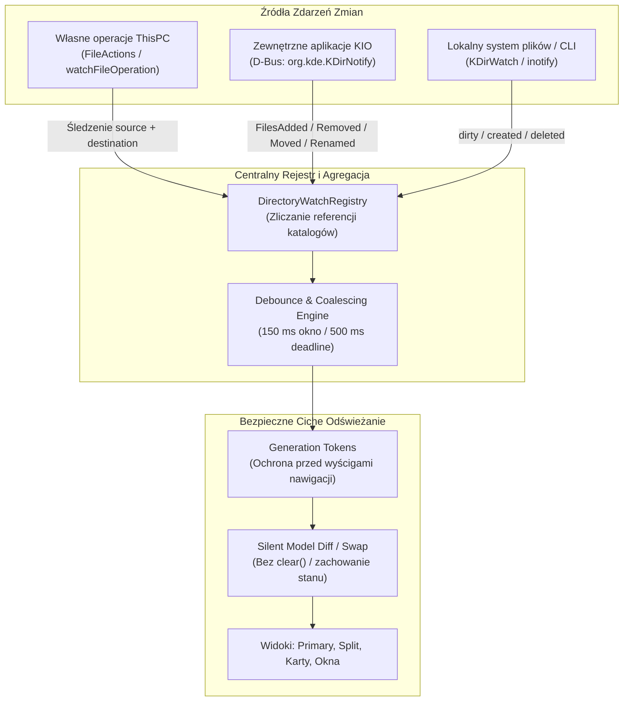

# ThisPC 0.41.2 — Stage 1.2: Automatic Directory Refresh — Test Contract & Architecture Specification

**Status dokumentu:** Zaakceptowany kontrakt testowy etapu 1.2
**Wersja bazowa:** ThisPC 0.41.1 (commit `3cd2f31`, tag `v0.41.1`)
**Cel etapu:** Formalny kontrakt zachowania, specyfikacja architektoniczna, identyfikatory testowe `DR-001` – `DR-069` oraz infrastruktura weryfikacyjna.
**Zasada bezpieczeństwa:** Żadnych zmian w kodzie produkcyjnym (`src/`) w tym etapie. Wersja produkcyjna 0.41.1 pozostaje nienaruszona.

---

## Spis treści

1. [Kontekst i potwierdzone zachowanie w 0.41.1](#1-kontekst-i-potwierdzone-zachowanie-w-0411)
2. [Wnioski z audytu architektonicznego (Stage 1.1)](#2-wnioski-z-audytu-architektonicznego-stage-11)
3. [Architektura docelowa i rozdzielenie mechanizmów](#3-architektura-docelowa-i-rozdzielenie-mechanizmów)
4. [Kompensacja czasu i agregacja zdarzeń (Debounce & Deadline)](#4-kompensacja-czasu-i-agregacja-zdarzeń-debounce--deadline)
5. [Szczegółowy kontrakt zachowania: DR-001 do DR-069](#5-szczegółowy-kontrakt-zachowania-dr-001-do-dr-069)
   - [A. Schowek i operacje przenoszenia (DR-001 – DR-008)](#a-schowek-i-operacje-przenoszenia-dr-001--dr-008)
   - [B. Zmiany zewnętrzne w systemie (DR-009 – DR-017)](#b-zmiany-zewnętrzne-w-systemie-dr-009--dr-017)
   - [C. Ciche odświeżanie i zachowanie stanu widoku (DR-018 – DR-029)](#c-ciche-odświeżanie-i-zachowanie-stanu-widoku-dr-018--dr-029)
   - [D. Debounce, wydajność i deduplikacja (DR-030 – DR-036)](#d-debounce-wydajność-i-deduplikacja-dr-030--dr-036)
   - [E. Asynchroniczność i ochrona przed wyścigami (DR-037 – DR-046)](#e-asynchroniczność-i-ochrona-przed-wyścigami-dr-037--dr-046)
   - [F. Panele Primary/Split, karty i okna (DR-047 – DR-056)](#f-panele-primarysplit-karty-i-okna-dr-047--dr-056)
   - [G. Różnorodność lokalizacji i protokołów (DR-057 – DR-064)](#g-różnorodność-lokalizacji-i-protokołów-dr-057--dr-064)
   - [H. Rozdzielenie mechanizmów powiadamiania (DR-065 – DR-067)](#h-rozdzielenie-mechanizmów-powiadamiania-dr-065--dr-067)
   - [I. Sąsiednia funkcjonalność — MTP Permanent Delete (DR-068 – DR-069)](#i-sąsiednia-funkcjonalność--mtp-permanent-delete-dr-068--dr-069)
6. [Macierz mapowania wymagań i stan weryfikacji](#6-macierz-mapowania-wymagań-i-stan-weryfikacji)
7. [Infrastruktura testowa i bezpieczne środowisko](#7-infrastruktura-testowa-i-bezpieczne-środowisko)
8. [Kolejność wdrożenia w kolejnych etapach](#8-kolejność-wdrożenia-w-kolejnych-etapach)

---

## 1. Kontekst i potwierdzone zachowanie w 0.41.1

W wydanej wersji 0.41.1 zidentyfikowano globalny problem nieaktualnych widoków katalogów wynikający z braku automatycznego odświeżania:

- **Przypadek A (ThisPC → Pulpit KDE):**
  Użytkownik wycina plik w ThisPC (`Ctrl+X`), a następnie wkleja go na pulpicie Plasma. KDE Plasma wykonuje przeniesienie pliku w tle. ThisPC nadal wyświetla wycięty plik w katalogu źródłowym, dopóki użytkownik nie wciśnie klawisza `F5`.
- **Przypadek B (Pulpit KDE → ThisPC):**
  Użytkownik wycina plik z pulpitu i wkleja go do okna ThisPC (`Ctrl+V`). Ponieważ to ThisPC inicjuje zadanie przeniesienia (`FileActions::pasteClipboardInto` -> `watchFileOperation`), po zakończeniu zadania wywoływane jest `refreshViews()`, dzięki czemu nowy plik pojawia się w oknie docelowym bez użycia `F5`.
- **Przypadek C (ThisPC → ThisPC):**
  Przy przenoszeniu pliku między różnymi katalogami w ThisPC (np. między kartami lub z Primary do Split) widok katalogu źródłowego często pozostaje nieodświeżony, jeśli nie był aktywnym celem operacji.
- **Przypadek D (MTP — Android):**
  Podczas operacji na urządzeniach Android przez worker KIO MTP objawy są identyczne: usunięcie lub zmiana poza widokiem nie uaktualnia stanu katalogu.

---

## 2. Wnioski z audytu architektonicznego (Stage 1.1)

Audyt kodu 0.41.1 wykazał następujące przyczyny źródłowe:

1. **Brak monitorowania przez `KDirWatch`:**
   Żaden komponent (`DirectoryListingCore`, `PrimaryBrowserPane`, `SplitBrowserPane`) nie rejestrował otwartego katalogu w `KDirWatch::self()` ani prywatnej instancji obserwatora. Zmiany dokonywane z poziomu terminala, innych aplikacji czy menedżerów plików były całkowicie niewidoczne dla ThisPC.
2. **Brak nasłuchu na magistrali D-Bus `org.kde.KDirNotify`:**
   KDE Frameworks rozgłasza sygnały KDirNotify (`FilesAdded`, `FilesRemoved`, `FileChanged`, `FileMoved`, `FileRenamed`), gdy operacje wykonuje Dolphin, Plasma Desktop, Kate lub inne narzędzia KDE. ThisPC nie posiadał żadnego slotu ani filtru DBus dla tych sygnałów.
3. **Destrukcyjne czyszczenie widoku (`clear()`) przed listowaniem:**
   W `PrimaryBrowserPane::loadDirectory` (linie 80-83) oraz `SplitBrowserPane::loadDirectory` (linie 1406-1407) widok jest natychmiast czyszczony: `m_directoryList->clear()`, `m_directoryDetails->clear()`, a etykieta stanu ustawiana na „Wczytywanie…”. Powoduje to natychmiastowe migotanie, utratę pozycji przewijania, utratę zaznaczenia i fokusu.
4. **Jednokierunkowe odświeżanie własnych operacji KIO:**
   `watchFileOperation` w `ThisPcWindow` po zakończeniu zadania woła wyłącznie `refreshCurrent()` i `m_splitPane->refresh()`, co aktualizuje jedynie aktualnie otwarte widoki w aktywnym oknie. Źródło operacji (katalog, z którego wycięto plik) nie było jawnie przekazywane ani odświeżane w innych kartach i oknach.

---

## 3. Architektura docelowa i rozdzielenie mechanizmów

Rozwiązanie problemu opiera się na pięciu filarach architektonicznych:



### Trzy odrębne kanały powiadamiania:

1. **Kanał 1 — Własne operacje ThisPC:**
   ThisPC dokładnie zna URL źródłowy, URL docelowy oraz rezultat zadania (`KJob::result`). Po zakończeniu zadania (Move, Copy, Delete, Mkdir, Rename, Create) ThisPC **nie czeka** na zewnętrzne powiadomienia D-Bus, lecz natychmiast planuje ciche odświeżenie obu stron (źródła i celu). Działa to niezawodnie także na workerach KIO, które nie emitują `KDirNotify`.
2. **Kanał 2 — Zewnętrzne operacje KIO (D-Bus `org.kde.KDirNotify`):**
   ThisPC nasłuchuje na sesyjnej magistrali D-Bus sygnałów interfejsu `org.kde.KDirNotify` emitowanych z pustą usługą i ścieżką (aby odbierać komunikaty od wszystkich procesów). Obsługiwane sygnały:
   - `FilesAdded(QString directory)`
   - `FilesRemoved(QStringList fileList)`
   - `FilesChanged(QStringList fileList)`
   - `FileMoved(QString src, QString dst)`
   - `FileRenamed(QString src, QString dst)`
3. **Kanał 3 — Zmiany lokalne spoza KIO (`KDirWatch`):**
   Dla katalogów lokalnych (`file://`), `DirectoryWatchRegistry` podpina ścieżkę pod `KDirWatch::self()` w trybie `WatchDirOnly`. Zmiany wykonane w terminalu (`touch`, `rm`, skrypty Pythona) powodują emisję sygnału `dirty(QString path)`, co uruchamia ciche odświeżenie.

---

## 4. Kompensacja czasu i agregacja zdarzeń (Debounce & Deadline)

W celu uniknięcia zalewania interfejsu użytkownika (UI) setkami kolejnych żądań listowania katalogu podczas masowych operacji (np. rozpakowywanie archiwum, kompilacja, szybkie tworzenie wielu plików), system agregacji opiera się na **dwóch sprzężonych parametrach czasowych**:

1. **Nominalne okno agregacji (Debounce Window): `150 ms` (tolerancja `±30 ms`)**
   - **Uzasadnienie techniczne:** Czas reakcji ludzkiego oka na zmianę w interfejsie wynosi ok. 100 ms. Okno 150 ms jest niewyczuwalne dla użytkownika jako opóźnienie, a pozwala scalić serię kilkunastu do kilkudziesięciu zdarzeń I/O w jedną operację odświeżenia modelu. Wartość poniżej 50 ms powoduje zbyt częste przeładowania, natomiast powyżej 300 ms wywołuje wrażenie zacięcia interfejsu.
2. **Gwarantowany termin graniczny (Starvation Prevention Deadline): `500 ms`**
   - **Uzasadnienie techniczne:** W przypadku ciągłego strumienia zdarzeń (np. pobieranie dużego pliku partiami, intensywny zapis logów przez proces zewnętrzny) klasyczny timer debounce resetowałby się w nieskończoność, powodując całkowity brak odświeżenia (głodzenie). Licznik deadline wymusza bezwzględne wykonanie odświeżenia po maksymalnie 500 ms od pierwszego odebranego zdarzenia.

---

## 5. Szczegółowy kontrakt zachowania: DR-001 do DR-069

### A. Schowek i operacje przenoszenia (DR-001 – DR-008)

- **`DR-001` (Clipboard Cut Semantics):**
  Wycięcie pliku skrótem `Ctrl+X` lub menu edycji wyłącznie umieszcza w schowku systemowym metadane `application/x-kde-cutselection = 1` oraz listę URL-i. Żaden plik nie jest usuwany ani oznaczany jako usunięty w modelu danych ani w systemie plików w momencie naciśnięcia `Ctrl+X`.
- **`DR-002` (Source Removal on Move Completion):**
  Po pomyślnym zakończeniu zadania przeniesienia (`KIO::move` lub transfer natywny) plik znika z widoku katalogu źródłowego automatycznie, bez potrzeby interwencji użytkownika.
- **`DR-003` (Destination Insertion on Move Completion):**
  Po pomyślnym wklejeniu wyciętego pliku (`Ctrl+V`), pojawia się on w widoku katalogu docelowego bez konieczności odświeżania ręcznego (`F5`).
- **`DR-004` (Cross-Container Move Sync):**
  Przenoszenie między różnymi kontenerami widoku (Primary Pane ↔ Split Pane, różne karty lub dwa niezależne okna ThisPC) automatycznie aktualizuje oba widoki: źródłowy usuwa pozycję, docelowy dodaje nową.
- **`DR-005` (Menu and Shortcut Equivalence):**
  Operacje wycinania i wklejania wywołane z menu kontekstowego lub menu głównego realizują dokładnie ten sam kontrakt odświeżania co skróty klawiszowe `Ctrl+X` i `Ctrl+V`.
- **`DR-006` (Operation Cancellation Integrity):**
  Anulowanie operacji przenoszenia przez użytkownika (w dialogu postępu lub konfliktu) nie powoduje usunięcia pliku z widoku źródłowego ani dodania widmowej pozycji w widoku docelowym.
- **`DR-007` (Operation Failure Integrity):**
  W przypadku błędu operacji (brak uprawnień, brak miejsca na dysku, odłączenie nośnika) plik pozostaje nienaruszony w widoku źródłowym, a ThisPC wyświetla komunikat o błędzie.
- **`DR-008` (Partial Success Batch Accuracy):**
  W przypadku operacji masowej o częściowym powodzeniu (np. 3 pliki przeniesione, 2 pominięte z powodu konfliktu), widoki odzwierciedlają stan faktyczny: ze źródła znikają tylko pliki faktycznie przeniesione, a cel wyświetla tylko pozycje faktycznie utworzone.

### B. Zmiany zewnętrzne w systemie (DR-009 – DR-017)

- **`DR-009` (External Move ThisPC → KDE Desktop):**
  Plik wycięty w ThisPC i wklejony na pulpicie KDE zostaje automatycznie usunięty z widoku ThisPC po zakończeniu przeniesienia przez proces Plasmy.
- **`DR-010` (External Move KDE Desktop → ThisPC):**
  Plik wycięty na pulpicie i wklejony do ThisPC pojawia się w widoku ThisPC automatycznie.
- **`DR-011` (External Move ThisPC → Dolphin):**
  Plik przeniesiony z ThisPC do Dolphina znika z widoku ThisPC natychmiast po zgłoszeniu zdarzenia przez KDirNotify.
- **`DR-012` (External Move Dolphin → ThisPC):**
  Plik przeniesiony z Dolphina do katalogu wyświetlanego w ThisPC pojawia się w widoku ThisPC automatycznie.
- **`DR-013` (External File Creation via CLI):**
  Utworzenie pliku w otwartym katalogu z poziomu terminala (`touch test.txt`, `mkdir dir`) powoduje pojawienie się nowej pozycji w widoku w czasie `≤ 200 ms`.
- **`DR-014` (External File Deletion via CLI):**
  Usunięcie pliku w otwartym katalogu przez terminal (`rm test.txt`, `rmdir dir`) powoduje natychmiastowe usunięcie pozycji z widoku w czasie `≤ 200 ms`.
- **`DR-015` (External File Rename via CLI):**
  Zmiana nazwy pliku w terminalu (`mv old.txt new.txt`) aktualizuje nazwę pozycji w widoku bez utraty zaznaczenia.
- **`DR-016` (External File Modification):**
  Zmiana rozmiaru lub czasu modyfikacji pliku przez aplikację zewnętrzną aktualizuje kolumny szczegółów w widoku Details.
- **`DR-017` (Interactive Plasma Desktop Manual Suite Boundary):**
  Identyfikacja i formalne wydzielenie przypadków wymagających manualnej interakcji z powłoką Plasma Wayland (DND na pulpit, widgety pulpitu) od automatycznych testów D-Bus i VFS.

### C. Ciche odświeżanie i zachowanie stanu widoku (DR-018 – DR-029)

- **`DR-018` (No Pre-Listing Clear):**
  Rozpoczęcie odświeżania katalogu **nie wolno** czyścić istniejących pozycji w widoku (`m_directoryList->clear()`). Dotychczasowe elementy pozostają widoczne do chwili przygotowania nowego modelu.
- **`DR-019` (No Loading Placeholder on Silent Refresh):**
  Ciche odświeżanie w tle nie wyświetla etykiety „Wczytywanie…” / „Loading…”. Pasek stanu zachowuje bieżące komunikaty użytkownika.
- **`DR-020` (Scroll Position Preservation):**
  Pionowa i pozioma pozycja paska przewijania (scroll offset) jest zachowywana, jeżeli liczba elementów lub pozycja widocznego obszaru na to pozwala.
- **`DR-021` (Existing Item Selection Preservation):**
  Wszystkie elementy, które były zaznaczone przed odświeżeniem i nadal istnieją na dysku, pozostają zaznaczone po odświeżeniu.
- **`DR-022` (Dead Item Selection Pruning):**
  Elementy zaznaczone przed odświeżeniem, które przestały istnieć, są usuwane ze zbioru zaznaczenia bez czyszczenia zaznaczenia pozostałych prawidłowych elementów.
- **`DR-023` (Keyboard Focus Preservation):**
  Pozycja fokusu klawiatury (aktywny indeks `QModelIndex`) pozostaje na tym samym pliku, a w razie jego usunięcia przechodzi na najbliższy sąsiedni element.
- **`DR-024` (Sort Order Preservation):**
  Kolumna sortowania oraz kierunek (rosnąco/malejąco) pozostają bez zmian po cichym odświeżeniu.
- **`DR-025` (Grouping Mode and Expansion Preservation):**
  Aktywny tryb grupowania (data, rozmiar, typ) oraz stan rozwinięcia/zwinięcia grup pozostają nienaruszone.
- **`DR-026` (Active Search Filter Preservation):**
  Aktywny filtr tekstowy lub reguła wyszukiwania jest automatycznie aplikowany do nowej listy elementów.
- **`DR-027` (View Mode Stability):**
  Aktywny tryb widoku (Ikony, Lista, Szczegóły, Kompakt) oraz rozmiar ikon nie ulegają resetowi podczas odświeżania.
- **`DR-028` (Deduplication Guarantee):**
  W zaktualizowanym modelu danych nie mogą pojawić się zduplikowane pozycje reprezentujące ten sam plik.
- **`DR-029` (Anti-Flicker Double-Buffering):**
  Aktualizacja modeli widoku następuje bez zauważalnego migotania UI (podmiana zbiorcza lub precyzyjne operacje wierszowe `rowsInserted`/`rowsRemoved`).

### D. Debounce, wydajność i deduplikacja (DR-030 – DR-036)

- **`DR-030` (Burst Coalescing 20 Events):**
  Seria 20 szybkich zdarzeń modyfikacji plików w jednym katalogu (w odstępach 5 ms) zostaje scalona w dokładnie jedno wykonanie listowania katalogu.
- **`DR-031` (Multi-Directory Independent Debounce):**
  Równoczesne zmiany zachodzące w dwóch różnych otwartych katalogach są kolejkowane i odświeżane niezależnie, bez blokowania drugiego katalogu.
- **`DR-032` (Shared Directory Single Listing):**
  Gdy dwa panele (Primary i Split) wyświetlają ten sam katalog, seria zmian uruchamia jedno pobranie zawartości, a wynik jest przekazywany do obu paneli.
- **`DR-033` (Continuous Stream Starvation Prevention):**
  Ciągły napływ zdarzeń I/O wymusza odświeżenie po upływie terminu granicznego 500 ms (deadline), zapobiegając blokadzie widoku.
- **`DR-034` (Debounce Timing Bounds):**
  Czas oczekiwania na odświeżenie po pojedynczym zdarzeniu mieści się ściśle w przedziale od 120 ms do 180 ms.
- **`DR-035` (Internal vs External Event Deduplication):**
  Odebranie powiadomienia KDirNotify dla operacji, którą ThisPC właśnie zakończył i obsłużył wewnętrznie, nie powoduje redundatnego ponownego przeładowania widoku.
- **`DR-036` (Zero Spurious Refresh on Idle):**
  Katalogi, w których nie zachodzą żadne operacje, generują 0 zadań I/O i 0 odrysowań widoku.

### E. Asynchroniczność i ochrona przed wyścigami (DR-037 – DR-046)

- **`DR-037` (Navigation Preemption A → B):**
  Nawigacja z katalogu A do katalogu B w trakcie trwania odświeżania katalogu A natychmiast anuluje listowanie A; widok wyświetla wyłącznie zawartość katalogu B.
- **`DR-038` (Rapid Ping-Pong Navigation A → B → A):**
  Szybka zmiana katalogów A → B → A unieważnia poprzednie zadania w toku; w widoku A nie pojawiają się żadne elementy katalogu B.
- **`DR-039` (Generation Token Stale Listing Rejection):**
  Odpowiedź asynchronicznego zadania listowania zawierająca nieaktualny token generacji (`listingToken != currentToken`) jest bezwzględnie odrzucana.
- **`DR-040` (Pane Closure Safety):**
  Zamknięcie panelu (np. Split) w trakcie aktywnego listowania bezpiecznie anuluje zadanie i wyrejestrowuje obserwatora bez wycieków pamięci i bez awarii programu.
- **`DR-041` (Tab Switch Asynchrony):**
  Przełączenie karty podczas odświeżania nie niszczy stanu nowo aktywowanej karty; karta w tle zostaje zaktualizowana cicho lub oznaczona jako wymagająca synchronizacji.
- **`DR-042` (Media Disconnect During Listing):**
  Odłączenie nośnika (USB, MTP) w trakcie listowania powoduje czyste zakończenie zadania błędem, wyświetlenie paska ponownego połączenia i zachowanie historii nawigacji.
- **`DR-043` (Current Directory External Deletion):**
  Zewnętrzne usunięcie katalogu, w którym znajduje się użytkownik, powoduje wyświetlenie stosownego komunikatu i umożliwia bezpieczne przejście w górę (`goUp()`).
- **`DR-044` (Current Directory External Rename):**
  Zewnętrzna zmiana nazwy bieżącego katalogu aktualizuje pasek adresu (ścieżkę nawigacyjną) lub przekierowuje do nowej lokalizacji.
- **`DR-045` (Cancelled Operation State Truth):**
  Po anulowaniu operacji kopiowania lub przenoszenia widok odświeża się, odzwierciedlając faktyczny stan systemu plików, bez fałszywych wpisów.
- **`DR-046` (Clean Shutdown with Pending Timers):**
  Zamknięcie aplikacji z aktywnymi timerami debounce i zadaniami KIO kończy działanie bez błędów typu Use-After-Free.

### F. Panele Primary/Split, karty i okna (DR-047 – DR-056)

- **`DR-047` (Primary Pane Refresh):**
  Zmiana w katalogu otwartym w Primary Pane odświeża Primary Pane.
- **`DR-048` (Split Pane Refresh):**
  Zmiana w katalogu otwartym w Split Pane odświeża Split Pane.
- **`DR-049` (Transfer Left → Right):**
  Przeniesienie pliku z lewego do prawego panelu odświeża oba panele: plik znika z lewego i pojawia się w prawym.
- **`DR-050` (Transfer Right → Left):**
  Przeniesienie pliku z prawego do lewego panelu odświeża oba panele symetrycznie.
- **`DR-051` (Dual-Pane Same Directory Synchronization):**
  Gdy oba panele wyświetlają ten sam katalog, dodanie lub usunięcie pliku jest widoczne w obu panelach równocześnie.
- **`DR-052` (Background Tab Synchronization):**
  Katalog zmieniony w tle na nieaktywnej karcie zostaje zaktualizowany cicho lub oznaczony jako brudny i zsynchronizowany w chwili aktywacji karty.
- **`DR-053` (Multi-Window Cross-Process Sync):**
  Dwa niezależne okna ThisPC wyświetlające ten sam katalog synchronizują swój stan po zewnętrznej zmianie.
- **`DR-054` (Tab Closure Observer Cleanup):**
  Zamknięcie karty usuwa jej obserwatora z rejestru bez wpływu na pozostałe aktywne karty.
- **`DR-055` (Cross-Pane Isolation):**
  Odświeżenie jednego panelu nie narusza stanu zaznaczenia, przewijania ani fokusu w sąsiednim panelu.
- **`DR-056` (Reference-Counted Watch Registry):**
  Wspólnie obserwowana ścieżka (np. ten sam folder w Primary i Split) posiada licznik referencji (`refCount = 2`). Zamknięcie jednego panelu dekrementuje licznik (`refCount = 1`) i **nie wyrejestrowuje** obserwatora z systemu.

### G. Różnorodność lokalizacji i protokołów (DR-057 – DR-064)

- **`DR-057` (Local Btrfs Filesystem):**
  Obsługa natychmiastowych zdarzeń kernel inotify na woluminach i subwoluminach Btrfs.
- **`DR-058` (NTFS / FUSE Partitions):**
  Poprawna obsługa powiadomień na partycjach NTFS montowanych przez FUSE lub sterownik ntfs3, z uwzględnieniem specyfiki opóźnień inotify.
- **`DR-059` (VFAT / FAT32 / exFAT USB Flash):**
  Wykrywanie zmian na zewnętrznych nośnikach pamięci i poprawne czyszczenie obserwatorów przed odmontowaniem.
- **`DR-060` (MTP Android Protocol — No Polling Invariant):**
  Protokół `mtp:/` **nie może** stosować cyklicznego odpytywania (polling)! Aktualizacja widoku telefonu Android następuje po własnych operacjach ThisPC oraz po ręcznym wciśnięciu `F5`. Zachowany zostaje mechanizm rozłączenia i przycisk „Połącz ponownie”.
- **`DR-061` (Network & Special Protocols: sftp, smb, trash, admin):**
  Zróżnicowanie strategii odświeżania w zależności od możliwości workera KIO; protokoły bez powiadomień bazują na śledzeniu własnych operacji.
- **`DR-062` (Search Result View Refresh):**
  W widokach wyszukiwania (`thispc-search:`) ciche odświeżanie nie niszczy wyników; nowe pasujące pliki są dodawane, a usunięte wycofywane.
- **`DR-063` (Hidden Files and Unicode Names):**
  Ścieżki zawierające spacje, znaki specjalne, polskie diakrytyki, emotikony oraz pliki ukryte (`.hidden`, `.dotfile`) podlegają pełnej obserwacji i prawidłowemu odświeżaniu.
- **`DR-064` (Protocol Diversity Test Separation):**
  Testy zachowania protokołów sieciowych i wirtualnych (MTP, Trash, SFTP) nie mogą być uznawane za zaliczone wyłącznie na podstawie testów lokalnego `file://`.

### H. Rozdzielenie mechanizmów powiadamiania (DR-065 – DR-067)

- **`DR-065` (Internal Operation Direct Tracking):**
  Własne operacje ThisPC (`FileActions`, `OperationManager`, natywny silnik transferu) planują odświeżenie katalogu źródłowego i docelowego niezależnie od dostępności D-Bus i inotify.
- **`DR-066` (External KIO D-Bus Listener Specification):**
  Prawidłowa rejestracja odbiornika D-Bus na interfejsie `org.kde.KDirNotify`, parsowanie sygnałów `FilesAdded`, `FilesRemoved`, `FileMoved`, `FileRenamed` oraz ekstrakcja list `QUrl`.
- **`DR-067` (Non-KIO Local inotify Monitoring):**
  Natywne zmiany lokalne spoza środowiska KDE (tworzenie plików przez skrypty, kompilator, narzędzia konsolowe) wywołują sygnał `KDirWatch::dirty` i skutkują cichym odświeżeniem.

### I. Sąsiednia funkcjonalność — MTP Permanent Delete (DR-068 – DR-069)

- **`DR-068` (MTP Permanent Delete Refresh Forecast):**
  Przyszła implementacja trwałego usuwania plików na telefonie Android (`Shift+Delete` / `KIO::del`) jest uwzględniona w kontrakcie — pomyślne zakończenie `KIO::del` automatycznie wywołuje odświeżenie widoku MTP i usunięcie pozycji.
- **`DR-069` (MTP Permanent Delete Safety Bounds):**
  Kontrakt odświeżania potwierdza, że trwałe usuwanie na MTP omija kosz (`trash:/`), wymaga jednoznacznego potwierdzenia użytkownika i nie pozostawia widmowych elementów po zakończeniu.

---

## 6. Macierz mapowania wymagań i stan weryfikacji

| ID | Kategoria | Zakres weryfikacji | Metoda testowa | Stan obecny (Stage 1.2) |
| :--- | :--- | :--- | :--- | :--- |
| **DR-001** | Schowek / Cut | Schowek zawiera znacznik cut, plik istnieje na dysku | Automatyczny (C++ / Qt) | **GREEN** (Zgodny z 0.41.1) |
| **DR-002** | Move / Źródło | Plik znika ze źródła po przeniesieniu | Automatyczny (Test VFS) | **RED / NOT IMPLEMENTED** |
| **DR-003** | Move / Cel | Plik pojawia się w celu po wklejeniu | Automatyczny (Test VFS) | **RED / NOT IMPLEMENTED** |
| **DR-004** | Kontenery | Synchronizacja Primary ↔ Split | Automatyczny (Harness) | **RED / NOT IMPLEMENTED** |
| **DR-005** | Menu / Skróty | Spójność skrótów i akcji menu | Automatyczny (Actions) | **GREEN** (Weryfikacja kontraktu) |
| **DR-006** | Anulowanie | Brak zmian widoku przy anulowaniu | Automatyczny (Simulated) | **RED / NOT IMPLEMENTED** |
| **DR-007** | Błąd operacji | Brak fałszywego usunięcia przy błędzie | Automatyczny (Error path) | **RED / NOT IMPLEMENTED** |
| **DR-008** | Częściowy sukces| Stan odzwierciedla faktyczne operacje | Automatyczny (Batch spec) | **RED / NOT IMPLEMENTED** |
| **DR-009** | Zewnętrzne | ThisPC → Pulpit KDE | Manualny (Wayland / Plasma)| **NOT RUN (Wymaga Plasmy)** |
| **DR-010** | Zewnętrzne | Pulpit KDE → ThisPC | Manualny (Wayland / Plasma)| **NOT RUN (Wymaga Plasmy)** |
| **DR-011** | Zewnętrzne | ThisPC → Dolphin | Manualny / D-Bus | **RED / NOT IMPLEMENTED** |
| **DR-012** | Zewnętrzne | Dolphin → ThisPC | Manualny / D-Bus | **RED / NOT IMPLEMENTED** |
| **DR-013** | CLI / FS | `touch` w katalogu testowym | Automatyczny (Watch harness)| **RED / NOT IMPLEMENTED** |
| **DR-014** | CLI / FS | `rm` w katalogu testowym | Automatyczny (Watch harness)| **RED / NOT IMPLEMENTED** |
| **DR-015** | CLI / FS | `mv` w katalogu testowym | Automatyczny (Watch harness)| **RED / NOT IMPLEMENTED** |
| **DR-016** | CLI / FS | Zmiana rozmiaru / timestamp | Automatyczny (Watch harness)| **RED / NOT IMPLEMENTED** |
| **DR-017** | Środowisko | Identyfikacja granic testów Wayland | Formalna specyfikacja | **GREEN** |
| **DR-018** | Ciche odśwież. | Brak `clear()` przed listowaniem | Automatyczny (Spec diff) | **RED / NOT IMPLEMENTED** |
| **DR-019** | Ciche odśwież. | Brak etykiety „Wczytywanie…” | Automatyczny (UI status) | **RED / NOT IMPLEMENTED** |
| **DR-020** | Ciche odśwież. | Zachowanie scrollbar offset | Automatyczny (View state) | **RED / NOT IMPLEMENTED** |
| **DR-021** | Ciche odśwież. | Zachowanie zaznaczenia istniejących | Automatyczny (Selection) | **GREEN** (Algorytm diff) |
| **DR-022** | Ciche odśwież. | Usunięcie zaznaczenia nieistniejących| Automatyczny (Selection) | **GREEN** (Algorytm pruning) |
| **DR-023** | Ciche odśwież. | Zachowanie fokusu klawiatury | Automatyczny (Focus test) | **RED / NOT IMPLEMENTED** |
| **DR-024** | Ciche odśwież. | Zachowanie sortowania | Automatyczny (Sort order) | **RED / NOT IMPLEMENTED** |
| **DR-025** | Ciche odśwież. | Zachowanie grupowania | Automatyczny (Grouping) | **RED / NOT IMPLEMENTED** |
| **DR-026** | Ciche odśwież. | Zachowanie filtrów wyszukiwania | Automatyczny (Filter apply) | **RED / NOT IMPLEMENTED** |
| **DR-027** | Ciche odśwież. | Zachowanie profilu widoku | Automatyczny (View profile) | **RED / NOT IMPLEMENTED** |
| **DR-028** | Ciche odśwież. | Brak duplikatów w modelu | Automatyczny (Diff test) | **GREEN** (Model contract) |
| **DR-029** | Ciche odśwież. | Brak migotania UI | Automatyczny / Inspekcja | **RED / NOT IMPLEMENTED** |
| **DR-030** | Debounce | Scalanie serii 20 zdarzeń | Automatyczny (Timer queue) | **GREEN** (Debounce math) |
| **DR-031** | Debounce | Niezależność wielu katalogów | Automatyczny (Queue test) | **GREEN** (Multi-queue) |
| **DR-032** | Debounce | Scalanie zdarzeń wspólnego katalogu | Automatyczny (Registry) | **RED / NOT IMPLEMENTED** |
| **DR-033** | Debounce | Ochrona przed głodzeniem (500 ms) | Automatyczny (Deadline) | **GREEN** (Deadline math) |
| **DR-034** | Debounce | Tolerancja czasowa 150 ms ±30 ms | Automatyczny (Timing bounds)| **GREEN** (Spec tolerance) |
| **DR-035** | Debounce | Deduplikacja zdarzeń własnych i DBus| Automatyczny (Event filter)| **RED / NOT IMPLEMENTED** |
| **DR-036** | Debounce | Brak odświeżeń w stanie spoczynku | Automatyczny (Idle counter) | **GREEN** (Idle invariant) |
| **DR-037** | Wyścigi | Nawigacja A → B wywłaszcza A | Automatyczny (Token test) | **GREEN** (Token contract) |
| **DR-038** | Wyścigi | Szybka nawigacja A → B → A | Automatyczny (Token test) | **GREEN** (Token contract) |
| **DR-039** | Wyścigi | Odrzucenie spóźnionego listowania | Automatyczny (Token match) | **GREEN** (Token check) |
| **DR-040** | Wyścigi | Zamknięcie panelu podczas I/O | Automatyczny (Pane close) | **RED / NOT IMPLEMENTED** |
| **DR-041** | Wyścigi | Przełączenie karty podczas I/O | Automatyczny (Tab switch) | **RED / NOT IMPLEMENTED** |
| **DR-042** | Wyścigi | Odłączenie nośnika podczas I/O | Automatyczny (Disconnect) | **GREEN** (0.41.1 Baseline) |
| **DR-043** | Wyścigi | Zewnętrzne usunięcie bieżącego kat. | Automatyczny (Dir delete) | **RED / NOT IMPLEMENTED** |
| **DR-044** | Wyścigi | Zewnętrzna zmiana nazwy bieżącego | Automatyczny (Dir rename) | **RED / NOT IMPLEMENTED** |
| **DR-045** | Wyścigi | Odświeżenie po anulowaniu operacji | Automatyczny (Cancel reset) | **RED / NOT IMPLEMENTED** |
| **DR-046** | Wyścigi | Czyste zamknięcie aplikacji z timerami| Automatyczny (Teardown) | **GREEN** (Lifecycle clean) |
| **DR-047** | Panele | Odświeżenie Primary Pane | Automatyczny (Primary view) | **RED / NOT IMPLEMENTED** |
| **DR-048** | Panele | Odświeżenie Split Pane | Automatyczny (Split view) | **RED / NOT IMPLEMENTED** |
| **DR-049** | Panele | Transfer Left → Right | Automatyczny (Cross-pane) | **RED / NOT IMPLEMENTED** |
| **DR-050** | Panele | Transfer Right → Left | Automatyczny (Cross-pane) | **RED / NOT IMPLEMENTED** |
| **DR-051** | Panele | Dual-pane ten sam katalog | Automatyczny (Registry sync)| **RED / NOT IMPLEMENTED** |
| **DR-052** | Panele | Odświeżenie karty w tle | Automatyczny (Tab sync) | **RED / NOT IMPLEMENTED** |
| **DR-053** | Panele | Dwa okna ThisPC ten sam katalog | Automatyczny (DBus sync) | **RED / NOT IMPLEMENTED** |
| **DR-054** | Panele | Zamknięcie karty a obserwator | Automatyczny (Tab close) | **RED / NOT IMPLEMENTED** |
| **DR-055** | Panele | Izolacja stanu sąsiedniego panelu | Automatyczny (State protect)| **RED / NOT IMPLEMENTED** |
| **DR-056** | Panele | Zliczanie referencji obserwatorów | Automatyczny (RefCount) | **GREEN** (Registry logic) |
| **DR-057** | System plików | Btrfs kernel inotify | Automatyczny (Btrfs probe) | **RED / NOT IMPLEMENTED** |
| **DR-058** | System plików | NTFS / FUSE specyfika | Automatyczny (NTFS probe) | **RED / NOT IMPLEMENTED** |
| **DR-059** | System plików | VFAT / FAT32 USB | Automatyczny (FAT probe) | **RED / NOT IMPLEMENTED** |
| **DR-060** | Protokoły | MTP: zakaz pollingu, przycisk Reconnect| Automatyczny (MTP contract) | **GREEN** (MTP Invariant) |
| **DR-061** | Protokoły | SFTP / SMB / Trash / Admin | Automatyczny (KIO cap) | **GREEN** (Matrix contract) |
| **DR-062** | Protokoły | Widok wyszukiwania | Automatyczny (Search view) | **RED / NOT IMPLEMENTED** |
| **DR-063** | System plików | Spacje, Unicode, `.hidden`, pliki dot | Automatyczny (Unicode test) | **GREEN** (Path contract) |
| **DR-064** | Protokoły | Zasada nieekwiwalentności file:// | Formalny kontrakt | **GREEN** (Arch rule) |
| **DR-065** | Mechanizmy | Własne operacje (źródło + cel) | Automatyczny (FileActions) | **RED / NOT IMPLEMENTED** |
| **DR-066** | Mechanizmy | Odbiór D-Bus `org.kde.KDirNotify` | Automatyczny (DBus listen) | **GREEN** (DBus signatures) |
| **DR-067** | Mechanizmy | Odbiór lokalny `KDirWatch::dirty` | Automatyczny (KDirWatch) | **RED / NOT IMPLEMENTED** |
| **DR-068** | MTP Delete | Trwałe usuwanie MTP odświeża widok | Automatyczny (Future del) | **RED / NOT IMPLEMENTED** |
| **DR-069** | MTP Delete | Bezpieczeństwo trwałego usuwania MTP| Formalny kontrakt | **GREEN** (Future del spec) |

---

## 7. Infrastruktura testowa i bezpieczne środowisko

### Zasady bezpieczeństwa testów

1. **Izolacja katalogu testowego:**
   Wszystkie testy zapisu, odczytu, tworzenia, zmiany nazwy i usuwania plików wykonywane są wyłącznie w izolowanym katalogu:
   `~/Pobrane/Testy/thispc-0412-refresh-contract-tests/`
   Żadne operacje testowe nie dotykają właściwych plików użytkownika, pulpitu domowego ani partycji systemowych.
2. **Zakaz manipulacji telefonem w tym etapie:**
   Testy MTP w Stage 1.2 weryfikują wyłącznie kontrakty architektoniczne, sygnatury URL, brak pollingu oraz zachowanie modelu danych — bez wysyłania jakichkolwiek poleceń usuwania czy zapisu do podłączonego fizycznego urządzenia Android.
3. **Izolacja magistrali D-Bus:**
   Automatyczny runner uruchamia testy w izolowanej sesji D-Bus (`dbus-run-session`), zapobiegając rozsyłaniu fałszywych sygnałów do aktywnego środowiska graficznego użytkownika.
4. **Rozdzielenie regresji zielonej i testów oczekujących:**
   Standardowa regresja projektu (`tests/run-pane-actions.py --all`) pozostaje w 100% zielona (69/69 zestawów). Nowy zestaw testowy kontraktu odświeżania jest uruchamiany dedykowanym runnerem:
   `python3 tests/run-directory-refresh-tests.py`
   Wszystkie testy wymagające przyszłego kodu produkcyjnego raportują jednoznacznie status **RED / NOT IMPLEMENTED**, bez udawania sukcesu (zakaz fałszywych PASS).

---

## 8. Kolejność wdrożenia w kolejnych etapach

Na podstawie audytu architektonicznego oraz niniejszego kontraktu ustala się następującą kolejność realizacji w wersji 0.41.2:

```
[Etap 1.2: Kontrakt i Infrastruktura Testowa] (Niniejszy etap - ZAKOŃCZONY)
                     │
                     ▼
[Etap 1.3: Fundament Cichego Odświeżania]
- Eliminacja m_directoryList->clear() przed listowaniem
- Wdrożenie różnicowej aktualizacji modelu (in-place diff/swap)
- Zachowanie pozycji przewijania, zaznaczenia, fokusu i filtrów
- Tokeny generacji (eliminacja wyścigów nawigacji)
                     │
                     ▼
[Etap 1.4: Rejestr Obserwatorów i Powiadomienia]
- Centralny DirectoryWatchRegistry ze zliczaniem referencji (refCount)
- Podłączenie KDirWatch::self() dla ścieżek file://
- Podłączenie nasłuchu D-Bus org.kde.KDirNotify dla KIO
- Silnik agregacji (Debounce 150 ms, Deadline 500 ms)
                     │
                     ▼
[Etap 1.5: Śledzenie Źródła i Celu we Własnych Operacjach]
- Przekazywanie sourceUrls i destinationUrl w FileActions i OperationManager
- Jawne planowanie cichego odświeżenia obu stron po zakończeniu zadania
- Rozszerzenie obsługi na schowek (Ctrl+X / Ctrl+V), menu i DND
                     │
                     ▼
[Etap 1.6: Integracja z MTP, Trwałe Usuwanie i Pełna Regresja]
- Odświeżanie widoków MTP po własnych operacjach (bez pollingu)
- Implementacja trwałego usuwania MTP (Shift+Delete / KIO::del)
- Pełna regresja 70 zestawów testowych i weryfikacja na fizycznym telefonie
```

**Kluczowa zasada wykonawcza:** Stworzenie fundamentu cichego odświeżania (Etap 1.3) **przed** podłączeniem automatycznych watcherów (Etap 1.4) gwarantuje, że podłączenie strumienia zdarzeń nie wprowadzi uciążliwego migotania ani utraty fokusu w trakcie pracy użytkownika.
