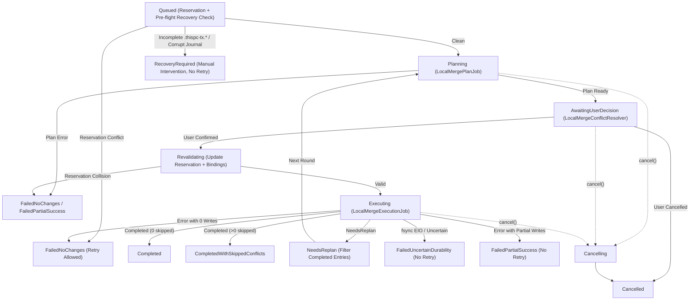

# ThisPC 0.45.1 — `FOLDER-MERGE-01` (Stage 1: Architecture, Safety Contract & Implementation Plan)

**Status:** `STAGE 1 DESIGN READY / AWAITING REVIEW`
**Worktree:** `~/Pobrane/kio-thispc-folder-merge-01` (gałąź `feat/folder-merge-01`, baza: `v0.45.0.1` @ `1a74f81678c591174061c15b3c59d6fee93796bf`)

---

## 1. Zweryfikowany baseline Git

- Główne repozytorium (`~/Pobrane/kio-thispc`): gałąź `main` i `origin/main` na `1a74f81678c591174061c15b3c59d6fee93796bf`, tag `v0.45.0.1` na tym samym commicie.
- Nowy izolowany worktree: `~/Pobrane/kio-thispc-folder-merge-01` (`feat/folder-merge-01`), oparty na `v0.45.0.1`.
- Instalacja systemowa `0.45.0.1`, tag `v0.45.0.1`, `fix/folder-collision-01`, backupy oraz `release-artifacts/` pozostają nietknięte.

---

## 2. Mapa aktualnego przepływu Copy (Primary / Split / DnD)

1. **Wejście akcji użytkownika**:
   - **Copy/Paste** (`Ctrl+C`/`Ctrl+V`, menu kontekstowe, pasek narzędzi): `ThisPcWindow::pasteClipboard()` → `ThisPcWindow::pasteClipboardInto()` (`src/thispcview.cpp`) → `FileActions::pasteClipboardInto()` (`src/fileactions.h:100`) → `enqueueProductionTransfer()`.
   - **Send To / Copy To**: `FileActions::copySelectionToDirectory()` (`src/fileactions.h:230`) → `enqueueProductionTransfer()`.
   - **Drag & Drop** (Primary/Split/Sidebar/Tabs): `FileActions::transferUrls()` (`src/fileactions.h:1558`) → `enqueueProductionTransfer()` (w `transferUrls` flaga `interactiveConflict` może być przekazana wg kontekstu wywołania).
2. **Klasyfikacja i kolizje w `FileActions::enqueueProductionTransfer()` (`src/fileactions.h:2123`)**:
   - `allLocal == true` i `sources.size() == 1` oraz `destinationDirectory.isLocalFile()`:
     - Sprawdzenie `targetInfo` w pętli `while (true)` (`src/fileactions.h:2193-2310`).
     - Dla zwykłego pliku: `KIO::RenameDialog` (w tym `C1` self-copy do tego samego katalogu bez opcji Overwrite, albo `C2` kolizja dwóch różnych plików z Overwrite/Rename/AutoRename/Skip/Cancel) → `LocalFileCopyJob`.
     - Dla istniejącego katalogu docelowego (`targetInfo.isDir()`, `src/fileactions.h:2207-2223`): **twarda blokada** przed utworzeniem zadania w kolejce (`m_showRecoveryFence(collisionMsg); return false;`).
   - `allLocal == true` i brak kolizji pojedynczego katalogu (lub partia wielu elementów):
     - Pojedynczy plik zwykły → `LocalFileCopyJob`.
     - Drzewo katalogów / partia → `LocalTransferJob` (`src/localtransferjob.h`) z `setFallbackFactory()` wskazującym `KIO::copy()`.
3. **Wykonanie w `LocalTransferJob` (`src/localtransferjob.h`)**:
   - `LocalTransferJob::plan()` uruchamia asynchronicznie `LocalTransferPlanJob` (`src/localtransferplan.h`).
   - `LocalTransferPlanWorker::appendEntry()` skanuje drzewo przez `::lstat()` + `::opendir()`/`::readdir()`, buduje płaską listę `LocalTransferPlanEntry` (katalogi przed dziećmi) oraz wylicza `destinationExists`, `destinationIsDirectory`, `destinationIsSymbolicLink`, `destinationSize` i `plan.conflictCount`.
   - `LocalTransferJob::validatePlan()` (`src/localtransferjob.h:144-166`) **obecnie odrzuca lub przekazuje do fallbacku `KIO::copy()`** każdy wpis z `entry.destinationExists == true`, jeśli nie jest to istniejący katalog niebędący symlinkiem (`entry.type != Directory || !entry.destinationIsDirectory || entry.destinationIsSymbolicLink`).
   - Dla nowych plików wywołuje `LocalFileCopyJob` (z `.thispc-part`, `fsync`, `renameat2(RENAME_NOREPLACE)`).
   - Dla istniejących katalogów bez konfliktów plików w środku `LocalTransferJob::next()` (`src/localtransferjob.h:231-242`) pomija `mkdir`, zachowuje `entry.destinationExists = true` (nie nadpisuje uprawnień/czasów istniejącego katalogu w `finishDirectories()`).
4. **Kolejka, rezerwacje, historia, UI**:
   - `TransferQueueController` (`src/transferqueuecontroller.h`) buduje `TransferReservation` (`src/transferreservationregistry.h`), pilnuje kolizji ścieżek aktywnych zadań i wyklucza retry przy `.thispc-part` lub istniejącym katalogu docelowym w `checkRetryEligibility()` (`src/transferqueuecontroller.h:1094`).
   - `OperationWindow`, `OperationPopup`, `TransferNotificationManager` i `TransferHistoryManager` obserwują sygnały `TransferQueueController`.
   - `FileUndoController` (`src/undocontroller.h:450`) przekazuje ukończone `LocalTransferJob` do `LocalTreeHistory::recordCompleted()`, które **akceptuje tylko transfery bez `usedKio()`** i zakłada, że cały wpis drzewa można odwrócić przez usunięcie skopiowanych plików/nowych katalogów.

---

## 3. Odpowiedzi A–J z audytu architektury

- **A. Blokada kolizji katalogów**: następuje w 3 miejscach:
  1. `FileActions::enqueueProductionTransfer()` (`src/fileactions.h:2207-2223`) — blokuje kolizję i self-copy pojedynczego katalogu lokalnego przed kolejką.
  2. `LocalTransferJob::validatePlan()` (`src/localtransferjob.h:155-161`) — blokuje (lub przekierowuje na `KIO::copy()`) każdy kolidujący plik/symlink w partii wieloelementowej.
  3. `TransferQueueController::checkRetryEligibility()` (`src/transferqueuecontroller.h:1094`) — blokuje ponowne uruchomienie zadania, jeśli w celu istnieje katalog.
- **B. `LocalTransferPlanJob`**: skanuje drzewo w osobnym wątku (`QThread`) bez blokowania UI i **już rejestruje** `destinationExists`, `destinationIsDirectory`, `destinationIsSymbolicLink`, `destinationSize`, `conflictCount`. Uwaga audytowa: w `src/localtransferplan.h:215-218` `QFileInfo::isDir()` podąża za symlinkami — przy `FOLDER-MERGE-01` trzeba użyć `localLstat()` (`S_ISDIR` / `S_ISLNK`), aby odróżnić prawdziwy katalog od symlinka wskazującego na katalog!
- **C. Transfer elementów**: pojedynczy plik → `LocalFileCopyJob` (chunki 256 KiB, staging `.thispc-part`, `fsync`, kontrola `LocalFileIdentity`, `renameat2`). Istniejący podkatalog w `LocalTransferJob` → pominięcie `mkdir` i brak nadpisania metadanych. Całe drzewo → iteracja po posortowanym `LocalTransferPlan`.
- **D. Fallback `KIO::copy()`**: uruchamiany z `LocalTransferJob::startFallback()` przy `UnsupportedEntry` lub konflikcie w `validatePlan()`. Daje obsługę KIO, ale **traci** natywną atomową publikację `LocalFileCopyJob`, dokładną kontrolę `LocalFileIdentity`, ochronę TOCTOU `renameat2(RENAME_NOREPLACE)` i nie rejestruje się w `LocalTreeHistory`. Dlatego przy `FOLDER-MERGE-01` **nie wolno** cicho spadać do `KIO::copy()` przy konfliktach plików/katalogów!
- **E. Wykrywanie nadpisania i kontrola tożsamości**: `LocalFileIdentity` (`src/localfileoverwrite.h:105`) porównuje `st_dev` i `st_ino` przez `::lstat()`. `LocalFileCopyWorker` weryfikuje przed publikacją, czy cel nadal ma tę samą tożsamość co w chwili decyzji (`DestinationChanged` przy TOCTOU).
- **F. Rezerwacja ścieżek (`TransferReservation`)**: budowana z `sources`, `destination` i `targetUrls`. Dla drzewa katalogów rezerwuje cały podobszar (`pathsOverlap`), co chroni przed równoległym zadaniem modyfikującym to samo drzewo docelowe.
- **G. Przerwanie, błąd, retry, częściowy sukces**: `LocalTransferJob` zapisuje `m_completedEntries` po każdym ukończonym elemencie. Przy błędzie pierwszego lub kolejnego pliku zatrzymuje się (`fail()`), ale elementy już opublikowane zostają w celu. `TransferQueueController::checkRetryEligibility()` odmawia automatycznego retry, gdy wykryje `.thispc-part` lub istniejące obiekty w celu (co chroni przed przypadkowym ponownym nadpisaniem).
- **H. Historia i GUI**: `TransferQueueController` emituje snapshoty do `OperationWindow`, `OperationPopup`, `TransferNotificationManager` oraz zapisuje wpis terminalny do `TransferHistoryManager` (z licznikami i statusem/błędem).
- **I. Undo/Redo (`FileUndoController` / `LocalTreeHistory`)**: **obecne `LocalTreeHistory` NIE może bezpiecznie cofać scalania zawierającego nadpisania plików**, ponieważ nie zachowuje kopii zapasowych zastąpionych plików (usunięcie w Undo trwale usunęłoby nadpisany oryginał!). Co więcej, przy częściowym sukcesie lub nadpisaniu musi zadziałać **fence (`m_irreversibleSerial`)** analogiczny do `thispcOverwritesDestination` w `src/undocontroller.h:467-478`. Bezpieczne Undo może dotyczyć wyłącznie scalania bez jakichkolwiek nadpisań (same nowe pliki/puste podkatalogi), albo wszystkie operacje scalania z co najmniej jednym zastąpieniem muszą jawnie oznaczać `thispcOverwritesDestination = true`.
- **J. Backendy zdalne (MTP, SFTP, SMB)**: wymagają osobnej architektury (brak `lstat`/`renameat2`/stabilnego `st_ino`, inna semantyka konfliktów w `KioStagedTransferJob`). Pozostają **poza zakresem `0.45.1`** (zablokowane tak jak dotychczas).

---

## 4. Proponowana architektura `FOLDER-MERGE-01` (Local-to-Local Copy)

1. **Asynchroniczne skanowanie i model planu scalania (`LocalMergePlan` / rozszerzenie `LocalTransferPlan`)**:
   - Skanowanie obu drzew (`LocalTransferPlanWorker`) w tle bez blokowania UI.
   - Zastosowanie `localLstat()` zarówno dla źródła, jak i celu każdego wpisu (`destinationType`: `Missing`, `RegularFile`, `Directory`, `SymLink`, `Special`).
   - Wykrywanie case-collision na systemach case-insensitive (NTFS/FAT) oraz duplikatów w tym samym drzewie.
   - Jawne blokowanie:
     - kopiowania katalogu do własnego podkatalogu (kanoniczne ścieżki + weryfikacja `st_dev`/`st_ino` przodków przeciw symlinkom/aliasom);
     - kopiowania katalogu do własnego rodzica (self-copy): osobny dialog z propozycją bezkolizyjnej nowej nazwy (`suggestedAvailableName`, np. `WTF (kopia)`) lub czytelną odmową — **nigdy scalanie z samym sobą**.
2. **Dwuetapowa faza decyzji w UI (przed startem zapisu w kolejce)**:
   - **Krok 1 — Dialog kolizji folderu** (gdy cel jest istniejącym katalogiem, a nie self-copy):
     - Tytuł: `Folder „<nazwa>” już istnieje` / `Folder "<name>" already exists`
     - Informacja o ścieżce źródła i celu (z zawijaniem/elidingiem długich ścieżek + pełny tooltip).
     - Akcje: **Scal zawartość folderów** (`Merge`), **Zmień nazwę kopiowanego folderu** (`Rename`), **Pomiń folder** (`Skip`), **Anuluj** (`Cancel`). Domyślny fokus bezpieczny (bez automatycznego nadpisywania).
     - Przy `Rename`: zmiana nazwy folderu docelowego na nową bezkolizyjną nazwę (pętla walidacji).
     - Przy `Merge`: przejście do asynchronicznego planowania konfliktów w poddrzewie.
   - **Krok 2 — Rozstrzyganie konfliktów w poddrzewie** (wyłącznie gdy `conflictCount > 0` dla plików / symlinków / niezgodności typów plik↔katalog):
     - Dla każdego kolidującego pliku: osobny dialog z **Zastąp** (`Overwrite`), **Pomiń** (`Skip`), **Zmień nazwę** (`Rename` z `suggestedAvailableName`), **Anuluj** (`Cancel`) oraz checkboxem **„Zastosuj do wszystkich pozostałych konfliktów plików”** (wyłącznie w zakresie konfliktów plik-na-plik; nie obejmuje niezgodności typów katalog↔plik ani błędów I/O).
     - Kliknięcie „Scal” w Kroku 1 **nigdy** nie implikuje „Zastąp wszystkie pliki”.
3. **Wykonanie w `LocalTransferJob` (tryb `MergePlan`)**:
   - Każdy wpis `LocalTransferPlanEntry` dostaje rozstrzygniętą akcję (`CopyNew`, `MergeIntoExistingDir`, `OverwriteFile`, `CopyRenamedFile`, `Skip`).
   - Brak cichego fallbacku do `KIO::copy()` przy konfliktach lub błędach!
   - Każdy zapisywany plik przechodzi przez `LocalFileCopyJob` z zachowaniem `LocalFileIdentity originalDestination` (dla `OverwriteFile`), stagingiem `.thispc-part`, `fsync` i `renameat2`.
   - Pliki istniejące wyłącznie w celu pozostają całkowicie nietknięte.
   - Puste podkatalogi ze źródła są tworzone w celu, jeśli nie istnieją.
   - Przy częściowym sukcesie i błędzie: raportowanie liczby ukończonych elementów, zachowanie opublikowanych plików, brak automatycznego retry mogącego nadpisać już opublikowane dane, oraz `m_irreversibleSerial` fence w `FileUndoController` gdy doszło do jakiegokolwiek nadpisania.

---

## 5. Kontrakt bezpieczeństwa danych (podsumowanie kluczowych reguł)

1. Zero modyfikacji w celu przed decyzją użytkownika; zero automatycznego usuwania plików istniejących tylko w celu.
2. Kontrola tożsamości `LocalFileIdentity` (`st_dev`, `st_ino`) przed publikacją każdego nadpisywanego pliku (ochrona TOCTOU).
3. Brak podążania za symlinkami przy rekurencji (`lstat` zamiast `stat`, `O_NOFOLLOW` / weryfikacja komponentów).
4. Symlinki kopiowane jako symlinki (albo odrzucane przy kolizji typów), bez rekurencji poza drzewo; uszkodzone symlinki wykrywane bezpiecznie.
5. Pliki specjalne (FIFO, socket, device node) blokowane przed startem jako nieobsługiwane.
6. Wykrywanie kolizji nazw różniących się wielkością liter na systemach case-insensitive (NTFS).
7. Rezerwacja `TransferReservation` obejmuje całe docelowe poddrzewo scalania, blokując równoległe zadania na tym samym drzewie.
8. Staging `.thispc-part` wyłącznie dla plików zwykłych i symlinków w `LocalFileCopyJob`/`transferLink`; brak pozostawionych `.thispc-part` po czystym anulowaniu lub błędzie otwarcia/zapisu.
9. Operacja scalania **nie jest przedstawiana jako atomowa dla całego drzewa** — atomowa jest publikacja pojedynczego pliku; przy błędzie w połowie użytkownik dostaje dokładny stan (ile plików skopiowano/nadpisano/pominięto i na czym operacja stanęła).
10. Brak automatycznego retry po częściowej publikacji z nadpisaniem.
11. `MOVE` i bramka `BtrfsOnly` pozostają nietknięte i poza zakresem `0.45.1`.

---

## 6. Macierz backendów i systemów plików

| Kierunek / System plików | Copy z Merge (`0.45.1`) | Uwagi |
|---|---|---|
| **Btrfs → Btrfs (Local)** | **TAK** | Pełne uprawnienia, czasy (`utimensat`), symlinki, `renameat2`, `fsync` |
| **Btrfs → NTFS (Local, ntfs3/ntfs-3g)** | **TAK** | Tolerancja na brak/ograniczenia POSIX `chmod`/uprawnień na NTFS (zgodnie z `docs/DECISIONS.md`), obsługa kolizji wielkości liter |
| **NTFS → NTFS (Local)** | **TAK** | Jak wyżej; wykrywanie case-insensitive kolizji |
| **ext4 / XFS / tmpfs (Local)** | **TAK** | Standardowe gwarancje `LocalFileCopyJob` + `lstat`/`renameat2` |
| **MTP / SFTP / SMB (zdalne ↔ lokalne)** | **NIE** | Poza zakresem `0.45.1` (wymaga odrębnej architektury `KioStagedTransferJob` / zdalnego listowania) |
| **MOVE (jakikolwiek z Merge)** | **NIE** | Wyłączone; bramka `BtrfsOnly` bez zmian |

---

## 7. Macierz testów automatycznych (A–Z)

Wszystkie 26 scenariuszy (**A–Z**) będą testowane wyłącznie na izolowanych katalogach tymczasowych (`QTemporaryDir`):
- **A–D**: Scalanie bez konfliktów, z pojedynczym konfliktem, z wieloma konfliktami (Zastąp/Pomiń/Zmień nazwę), Apply-to-All oraz Anuluj.
- **E–I**: Głębokie zagnieżdżenie, puste katalogi i puste pliki, kolizje wielkości liter (symulacja/case-insensitive), symlink do pliku i do katalogu, uszkodzony symlink.
- **J–M**: Self-copy do własnego rodzica (propozycja nowej nazwy / odmowa, nigdy merge z samym sobą), kopiowanie do własnego potomka (w tym przez symlink), zmiana tożsamości pliku po planowaniu (TOCTOU `DestinationChanged`), zmiana typu celu w trakcie kopiowania.
- **N–S**: Brak miejsca (`ENOSPC`), brak uprawnień (`EACCES`), anulowanie przed pierwszym zapisem, anulowanie w trakcie, błąd w czasie publikacji, odmowa niebezpiecznego retry po częściowym sukcesie.
- **T–Z**: Dwa równoległe transfery do tego samego drzewa (blokada rezerwacji), Batch Copy wielu folderów, routing Copy/Paste i DnD w Primary/Split, zachowanie plików istniejących wyłącznie w celu, brak regresji `C1`/`C2`/`FOLDER-COLLISION-01`, weryfikacja SHA-256 plików po każdej decyzji, brak sierocych `.thispc-part`.

---

## 8. Etapowy harmonogram implementacji i lista plików

### Kolejność małych, niezależnie testowalnych wycinków:
1. **Stage 2A (Planner & Safety Core)**: rozszerzenie `src/localtransferplan.h` (`localLstat`, typy kolizji, wykrywanie case-collision, self/descendant check) + jednostkowe testy planera.
2. **Stage 2B (Merge Execution Engine)**: dodanie rozstrzygniętych decyzji per wpis w `src/localtransferjob.h` (`OverwriteFile`, `CopyRenamedFile`, `Skip`, `MergeIntoExistingDir`), brak cichego fallbacku `KIO::copy()`, raportowanie częściowego sukcesu + testy silnika (A–T, W–Z).
3. **Stage 3 (Dialogi & UX)**: dialog kolizji folderu + dialog konfliktów plików z `Apply to All` (PL/EN, skróty klawiaturowe, Dark/Light Qt/KDE, bez blokowania UI podczas skanowania) + podpięcie w `src/fileactions.h` (Primary/Split Copy/Paste i DnD) + testy UI/akcji.
4. **Stage 4 (Kolejka, Historia, Undo Fence & Regresja)**: integracja z `src/transferqueuecontroller.h` (retry guard dla częściowego merge), `src/undocontroller.h` (bezpieczny fence przy nadpisaniach), testy na Btrfs/NTFS i pełna regresja `80/80` + nowe testy `FOLDER-MERGE-01`.
5. **Stage 5 (Final Manual Acceptance & Release `0.45.1`)**: odbiór ręczny (w tym kontrolowany test `WTF`), aktualizacja wersji, backup i publikacja.

### Przewidywane zmiany w plikach:
- `src/localtransferplan.h` — `lstat`-bezpieczna klasyfikacja celów, rozbudowa wpisu planu o typ kolizji i decyzję.
- `src/localtransferjob.h` — wykonanie planu scalania per wpis, zliczanie ukończonych/pominiętych/nadpisanych elementów, blokada niepożądanego fallbacku `KIO::copy()`.
- `src/fileactions.h` — zastąpienie sztywnej odmowy z linii `2207-2223` dwuetapowym przepływem (self-copy rename vs dialog `Scal / Zmień nazwę / Pomiń / Anuluj` + asynchroniczne skanowanie i dialog konfliktów plików).
- Nowy lekki nagłówek dialogów scalania (np. `src/foldermergedialog.h`) — dialog kolizji folderu oraz dialog konfliktów plików z `Apply to All`.
- `src/transferqueuecontroller.h` — doprecyzowanie `checkRetryEligibility()` i opisów zadań scalania.
- `src/undocontroller.h` / `src/localtreehistory.h` — fence nieodwracalności przy nadpisaniu podczas scalania.
- `tests/` — dedykowane testy `FOLDER-MERGE-01` (A–Z) oraz aktualizacja asercji z `FOLDER-COLLISION-01` tam, gdzie wcześniej oczekiwano bezwarunkowej blokady kolizji katalogów (z zachowaniem testów dla self-copy i `KioStagedTransferJob`).

---

## 9. Główne ryzyka i kolizje z istniejącymi testami

1. **Kolizja z testami `FOLDER-COLLISION-01` w `tests/file-actions.cpp`**: dotychczasowe testy sprawdzają, że kolizja dwóch różnych katalogów zwraca odmowę z komunikatem recovery fence. Po włączeniu `FOLDER-MERGE-01` w `0.45.1` dialog kolizji folderu zastąpi tę odmowę dla różnych katalogów, natomiast odmowa/propozycja nowej nazwy dla self-copy oraz blokada katalogów w `KioStagedTransferJob` pozostaną bez zmian.
2. **Symlinki w `LocalTransferPlanWorker`**: obecne użycie `QFileInfo::isDir()` może pomylić symlink do katalogu z katalogiem docelowym — wymagana zamiana na `localLstat()`.
3. **Błędne Undo po nadpisaniu**: gdyby `LocalTreeHistory` zapisało scalanie zawierające nadpisane pliki, `Ctrl+Z` usunęłoby nadpisane pliki zamiast przywrócić oryginały — obowiązkowe bramkowanie przez `m_irreversibleSerial`.
4. **Uprawnienia NTFS**: niepowodzenie `chmod`/`utimensat` na katalogach NTFS nie może przerywać poprawnie skopiowanych danych bez potrzeby — musi pozostać spójne z obecną polityką `LocalFileCopyJob` / `docs/DECISIONS.md`.

---

## 10. Rekomendacja pierwszego małego wycinka implementacyjnego

Rozpocząć **Stage 2A**: dodać w `src/localtransferplan.h` `lstat`-bezpieczną klasyfikację wpisów docelowych (`Missing` / `RegularFile` / `Directory` / `SymLink` / `Special`), wykrywanie konfliktu self/descendant oraz model decyzji per wpis (`MergeEntryAction`), wraz z izolowanymi testami jednostkowymi planera — bez ruszania jeszcze UI ani kolejki.

---

## 11. Stage 2B.1 — Safe Additive Local Merge Engine (zaimplementowano)

### Model zatwierdzania planu
- `LocalMergeExecutionJob` (`src/localmergeexecutionjob.h`) przyjmuje wyłącznie `LocalMergePlan` z jawnymi decyzjami `approvedAction`.
- Domyślny stan `Unapproved` oraz `pendingDecision = NoneNeeded` **nigdy** nie uprawniają do modyfikacji systemu plików; brak jawnego zatwierdzenia przerywa zadanie przed pierwszym zapisem.
- Decyzja na katalogu nadrzędnym ogranicza potomków (`m_approvedDirectories`): element podrzędny nie może zostać utworzony, jeśli jego rodzic nie został jawnie zatwierdzony jako `Create` lub `MergeDirectory`.
- Funkcja pomocnicza `approveAdditiveMergePlan(LocalMergePlan &)` zatwierdza wyłącznie `CreateNew` (zwykłe pliki i katalogi) oraz `MergeDirectoryCandidate`, natomiast `FileConflict` ustawia jawnie jako `Skip` i nigdy nie zatwierdza nadpisań, konfliktów typów, symlinków ani nazw niejednoznacznych.

### Sposób wykonania i zabezpieczenia TOCTOU
- Każdy wpis weryfikuje tożsamość obiektu źródłowego (`st_dev`, `st_ino`) przez `openat(..., O_NOFOLLOW | O_CLOEXEC)` + `fstat()`.
- Ścieżki docelowe otwierane są segment po segmencie przez `openDirectoryNoSymlinks()` z `O_RDONLY | O_DIRECTORY | O_NOFOLLOW | O_CLOEXEC`, co uniemożliwia przekierowanie zapisu przez podstawiony symlink pośredni.
- Nowe katalogi tworzone są przez `mkdirat(parentFd, name, 0755)` (odmowa przy `EEXIST`).
- Istniejące katalogi docelowe (`MergeDirectoryCandidate`) mają weryfikowaną tożsamość (`st_dev`, `st_ino`), ale **nie** są usuwane, zastępowane ani modyfikowane (`chmod`/`utimensat` pominięte).
- Nowe pliki przed uruchomieniem `LocalFileCopyJob(..., overwrite=false)` przechodzą `fstatat(parentFd, ..., AT_SYMLINK_NOFOLLOW)` oczekujące `ENOENT`; sam zapis zachowuje staging `.thispc-part`, `fsync` i `renameat2(RENAME_NOREPLACE)`.

### Granice wsparcia systemów plików, anulowanie i częściowy sukces
- Obsługiwany wyłącznie **Local-to-Local ADDITIVE COPY** (Btrfs, ext4, XFS, tmpfs, NTFS z zastrzeżeniem case-collision fail-closed przy niejednoznaczności i ograniczeń POSIX uprawnień).
- Operacja nie jest atomowa dla całego drzewa; `LocalMergeExecutionReport` raportuje osobno: `filesCreated`, `directoriesCreated`, `existingDirectoriesUsed`, `conflictsSkipped`, `objectsBlocked`, `failedOperations`, `bytesProcessed`, `lastPublishedEntry`, `completedFully`, `partialSuccess`, `cancelled`.
- Przy anulowaniu lub błędzie I/O (`ENOSPC` itp.) silnik przerywa natychmiast dalsze kroki, nie wykonuje automatycznego retry i nie uruchamia rekurencyjnego cleanupu.

### Ograniczenia przechodzące do Stage 2B.2
- Brak nadpisywania plików (`Overwrite`) i zmiany nazw (`Rename`) przy `FileConflict` (wymaga dialogów i jawnych decyzji z Stage 2B.2 / Stage 3).
- Brak integracji z `TransferQueueController`, `FileActions` i `FileUndoController` (produkcyjny Copy, Move i Undo/Redo pozostają nietknięte).

---

## 12. Stage 2B.2A — Security Audit, Skip, Rename & Policy Scoping (zaimplementowano)

### Audyt bezpieczeństwa Stage 2B.1 — wykryte okna TOCTOU i ich domknięcie
Audyt `LocalMergeExecutionJob` + `LocalFileCopyJob` + `publishOwnedStagingNoOverwrite` ujawnił **realne okna TOCTOU** pomiędzy sprawdzeniem deskryptora w `handleCreateFile()` a operacjami ścieżkowymi w `LocalFileCopyWorker` / `publishOwnedStagingNoOverwrite` (ponowne otwieranie katalogu po stringu bez `O_NOFOLLOW`, otwieranie źródła i `.thispc-part` przez `QFile`).
- **Naprawa**: wprowadzono `LocalAnchoredFileCopyJob` / `LocalAnchoredFileCopyWorker` oraz trwałą mapę otwartych deskryptorów katalogów (`m_srcDirFds`, `m_destDirFds`). Wszystkie wywołania systemowe (`openat(..., O_NOFOLLOW)`, `fstat`, `mkdirat`, `fstatat(..., AT_SYMLINK_NOFOLLOW)`, `linkat(AT_EMPTY_PATH)` / `renameat2(..., RENAME_NOREPLACE)`, `unlinkat`, `fsync(destParentFd)`) są zakotwiczone bezpośrednio na otwartych deskryptorach katalogów przez cały czas trwania zadania.

### Model decyzji `Skip`, `Rename` i zakres `ApplyToAll`
- Każda decyzja (`approveFileSkip`, `applySkipAllFileConflictsPolicy`, `approveFileRename`) wiąże wpis z `LocalMergeDecisionBinding`: klasyfikacją konfliktu, tożsamością źródła (`st_dev`, `st_ino`), tożsamością celu, deskryptorem/statem katalogu rodzica oraz zakresem polityki (`LocalMergeApplyPolicy`).
- **`Skip`**: zachowuje oba pliki, rejestruje `LocalMergeSkippedEntry` z powodem i tożsamościami, nie traktuje pominięcia jako błędu.
- **`ApplyToAll` (`SkipAllFileConflicts`)**: dotyczy wyłącznie `FileConflict` z `ExactNameMatch` w bieżącym planie; nigdy nie obejmuje konfliktów typów, symlinków, kolizji wielkości liter/Unicode ani nie zamienia się w `Overwrite`.
- **`Rename`**: dopuszcza wyłącznie pojedynczy bezpieczny komponent nazwy (bez `/`, `\`, `..`, `.`, NUL), weryfikuje brak kolizji dokładnych, case-insensitive, symlinków i uszkodzonych symlinków, sprawdza brak duplikatu w planie oraz publikuje wyłącznie atomowo przez `no-replace`.

### Model częściowego sukcesu i granica między 2B.2A a 2B.2B
- `LocalMergeExecutionOutcome`: `Succeeded`, `SucceededWithSkippedConflicts`, `CancelledNoChanges`, `CancelledPartialSuccess`, `FailedNoChanges`, `FailedPartialSuccess`, `FailedUncertainDurability`.
- `retryAllowed == false` zawsze przy `partialSuccess == true` lub `uncertainDurability == true` (`fsync(destParentFd)` EIO).
- **Granica 2B.2A → 2B.2B**: w 2B.2A `Overwrite` jest jawnie odrzucane. Przyszłe 2B.2B (`Overwrite`) będzie wymagało: (1) atomowej wymiany zakotwiczonej na deskryptorach (`renameat2(RENAME_EXCHANGE)` lub równoważnej weryfikacji `LocalFileIdentity` na tym samym `destParentFd`), (2) jawnej zgody na utratę poprzedniego pliku oraz (3) bramkowania Undo/Redo (`m_irreversibleSerial`).

## 13. Stage 2B.2B — Safe Overwrite Engine & Durability Contract

### Audyt silnika Stage 2B.2A (punkty A–F)
- **A (`linkat AT_EMPTY_PATH`)**: w Linux bez `CAP_DAC_READ_SEARCH` `linkat(fd, "", ..., AT_EMPTY_PATH)` zwraca `ENOENT`/`EPERM` dla zwykłych plików i przechodzi na `/proc/self/fd/<fd>` z `AT_SYMLINK_FOLLOW`. Dla `O_TMPFILE` (otwartego bez `O_EXCL`) materializacja przez `/proc/self/fd/<fd>` działa również bez podniesionych uprawnień.
- **B (`O_TMPFILE` fallback)**: gdy `O_TMPFILE` jest niedostępne lub wyłączone, silnik tworzy zakotwiczony plik nazwany `openat(destParentFd, ".thispc-part.<dst>.<pid>.<seq>", O_WRONLY | O_CREAT | O_EXCL | O_NOFOLLOW | O_CLOEXEC)` i weryfikuje `(st_dev, st_ino)` przed każdym `unlinkat`.
- **C (przeniesienie katalogu poza drzewo)**: weryfikacja `verifyDirectoryChainStillAnchored()` przechodzi ścieżkę od `m_srcRootFd` / `m_destRootFd` w dół do `parentFd` przed operacją i przed publikacją (z jawną granicą Linuksa: brak atomowego `rename`-locka w jądrze między ostatnim sprawdzeniem a syscallem).
- **D (metadane źródła i celu)**: sprawdzane `statIdentityExactMatch()` (`st_dev`, `st_ino`, `st_mode`, `st_size`, `st_mtim`) przed otwarciem, po odczycie źródła i bezpośrednio przed wymianą.
- **E (`fsync EIO` po publikacji)**: w `Overwrite` wyparty stary plik (`.thispc-replaced.<dst>.<pid>.<seq>`) NIE jest usuwany przed `fsync(destParentFd)`. Przy błędzie `fsync` zachowuje się go na dysku i rejestruje w `LocalMergeReplacedFileRecord` (`backupPreserved = true`, `recoveryPath`).
- **F (`partialSuccess` / `retryAllowed`)**: `hasPublishedAnything()` uwzględnia `filesOverwritten`; przy `partialSuccess` lub `uncertainDurability` pole `retryAllowed` wynosi `false`.

### Strategia Overwrite i granica atomowości Linuksa
1. Staging `NEW` przez `O_TMPFILE` (lub zakotwiczony `O_CREAT|O_EXCL`), `fsync(stageFd)`, `fchmod`, `futimens`.
2. Materializacja `O_TMPFILE` pod unikalną nazwą `.thispc-part...` w `destParentFd`.
3. Weryfikacja `fstatat(destParentFd, dst)` vs związana tożsamość `expectedDestinationStat`.
4. Atomowe `renameat2(destParentFd, part, destParentFd, dst, RENAME_EXCHANGE)`.
5. **Kontrola po wymianie**: `fstatat(destParentFd, part)` sprawdza i-węzeł wyparty z `dst`. Ponieważ Linux `RENAME_EXCHANGE` nie jest atomowym compare-and-swap po `(st_dev, st_ino)`, podmiana `dst` przez obcy proces w oknie między krokiem 3 a 4 zostaje wykryta po fakcie w kroku 5: silnik próbuje bezpiecznego wycofania (`RENAME_EXCHANGE` z powrotem), a jeśli to niemożliwe — zachowuje obiekt w `.thispc-part...` bez cichego usuwania.
6. `fsync(destParentFd)` — przy `EIO` raportuje `FailedUncertainDurability`, zachowuje kopię poprzedniego pliku i blokuje automatyczne `retry`. Po potwierdzonym `fsync` weryfikuje i-węzeł kopii przed `unlinkat`.

### Macierz systemów plików (Overwrite)
- **Btrfs / ext4 / XFS / tmpfs**: dozwolone (natywne `renameat2(RENAME_EXCHANGE)` + POSIX `fsync`).
- **VFAT/FAT32 (`MSDOS_SUPER_MAGIC`)**: zablokowane (brak `RENAME_EXCHANGE`, brak linkat).
- **NTFS-3G (`FUSE_SUPER_MAGIC`) / `ntfs3` (`NTFS3_SUPER_MAGIC`, `NTFS_SB_MAGIC`)**: zablokowane fail-closed do czasu osobnej weryfikacji atomowości `RENAME_EXCHANGE`, kolizji wielkości liter oraz trwałości `fsync` na NTFS.

### Kontrakt Undo/Redo (`LocalMergeUndoContract`)
- Nadpisanie (`filesOverwritten`) lub `uncertainDurability` wymaga `requiresIrreversibleSerial = true` i `reversible = false` w przyszłym `FileUndoController` (chyba że kopia odzyskiwania jest jawnie zachowana do osobnej obsługi).
- Istniejące wcześniej katalogi (`existingDirectoriesNeverDelete`) nigdy nie mogą zostać usunięte przez Undo.

## 14. Stage 2B.2B-R — Final Overwrite Security & Recovery Review

### Korekty bezpieczeństwa wprowadzone w Stage 2B.2B-R
1. **Kolejność metadanych i `fsync(stageFd)`**: `fchmod()` i `futimens()` wykonują się teraz **przed** `fsync(stageFd)`, aby uprawnienia i czasy modyfikacji były zsynchronizowane przed publikacją.
2. **Wzmocnione cofanie wymiany (rollback)**: przed próbnym cofnięciem `RENAME_EXCHANGE` weryfikujemy zarówno `partEnc` (nadal `displacedStat`), jak i `dstEnc` (nadal `stageStat`), a po cofnięciu sprawdzamy, czy `partEnc` odzyskał `stageStat`. Jeśli podczas cofania nastąpił kolejny wyścig, wyparty obiekt **nie jest usuwany** i otrzymuje jawną nazwę `.thispc-replaced.*`.
3. **Separacja `.thispc-replaced.*` od `.thispc-part.*`**: każda zachowana kopia odzyskiwania jest przenoszona pod unikalną nazwę `.thispc-replaced.<dst>.<pid>.<seq>` (z ponowieniem przy kolizji `EEXIST`), dzięki czemu żaden mechanizm porządkujący `.thispc-part.*` nie usunie kopii odzyskiwania.

### Analiza faz awarii procesu / zasilania (A–F)
- **A (staging utworzony, nieopublikowany)**: z `O_TMPFILE` brak wpisu katalogowego; z fallbackiem `.thispc-part.*` pozostaje wyłącznie bezpieczny plik tymczasowy — oryginał `dst` nietknięty.
- **B (staging zsynchronizowany, przed wymianą)**: `dst` nadal wskazuje kompletny `OLD`; staging nie został opublikowany.
- **C (`RENAME_EXCHANGE` zakończony, `OLD` pod nazwą tymczasową)**: `dst` wskazuje kompletny, zsynchronizowany `NEW`, a `OLD` znajduje się na dysku pod `.thispc-part.*` (żadne dane nie zostały usunięte).
- **D (zmiana nazwy na `.thispc-replaced.*`)**: `renameat2(RENAME_NOREPLACE)` jest atomowe — `OLD` ma albo starą nazwę tymczasową, albo `.thispc-replaced.*`.
- **E (błąd `fsync(destParentFd)`)**: raport `FailedUncertainDurability`, `retryAllowed = false`, `backupPreserved = true` — `.thispc-replaced.*` pozostaje na dysku z podanym `recoveryPath`.
- **F (publikacja potwierdzona, trwa cleanup)**: `fsync(destParentFd)` już potwierdził `NEW`; przed `unlinkat(.thispc-replaced.*)` weryfikowany jest `(st_dev, st_ino)`. W razie awarii w trakcie cleanupu na dysku zostaje co najwyżej nadmiarowa kopia `.thispc-replaced.*`, nigdy utrata danych.

### Projekt oddzielnej ścieżki odbioru NTFS (`/mnt/d`)
- **Rozróżnienie sterowników**:
  - `NTFS-3G` (`FUSE_SUPER_MAGIC`, FUSE user-space): brak gwarancji `RENAME_EXCHANGE` (zwykle `EINVAL`/`EOPNOTSUPP`), zależne od opcji montowania `fsync` i brak pełnej semantyki POSIX i-węzłów na części konfiguracji.
  - `ntfs3` (jądrowy sterownik, `NTFS3_SUPER_MAGIC` / `NTFS_SB_MAGIC`): wymaga osobnego testu możliwości konkretnego wolumenu (`O_TMPFILE`, `renameat2(RENAME_EXCHANGE)`, `linkat`, `fsync` katalogu, kolizje wielkości liter bez `casefold` ext4).
- **Protokół wykrywania możliwości (Stage 3 / osobny odbiór na wydzielonym katalogu testowym)**:
  1. Jawna zgoda użytkownika na test w wydzielonym katalogu na `/mnt/d` (bez danych WoW).
  2. Sonda `fstatfs()` + weryfikacja rzeczywistego zachowania `RENAME_EXCHANGE`, `fsync(dirFd)` oraz wariantów wielkości liter (`Config.wtf` vs `config.wtf`).
  3. **Jeśli wolumen/sterownik nie przejdzie sondy lub jest na NTFS-3G**: `Overwrite` pozostaje zablokowane, a UX w dialogu konfliktów zezwala wyłącznie na `Skip` / `Rename` (bez ukrytego niebezpiecznego `unlink + rename`).

## 15. Stage 3A — Izolowane dialogi konfliktów oraz plan zabezpieczeń przed Stage 3B

### Architektura dialogów (Stage 3A)
- [localmergedialogs.h](file:///home/sebastianh/Pobrane/kio-thispc-folder-merge-01/src/localmergedialogs.h):
  - `LocalMergeBackendCapabilities` — jawny model rozdzielający: `canMergeDirectories`, `canCreateNewFiles`, `canRenameConflictingCopies`, `canSafeOverwrite`, `filesystemLabel`, `overwriteUnavailableReason`.
  - `LocalFolderMergeConflictDialog` — obsługa `MergeDirectoryCandidate` oraz blokada scalania dla `SameObject` (self-copy oferuje wyłącznie `Rename` / `Skip` / `Cancel`).
  - `LocalFileConflictResolutionDialog` — obsługa `FileConflict` oraz blokada `Overwrite` i `ApplyToAll` dla symlinków, konfliktów typów, kolizji wielkości liter oraz backendów z `canSafeOverwrite == false` (np. NTFS-3G / niezweryfikowane `ntfs3`). Domyślną akcją jest zawsze bezpieczne `Skip`.

### Plan zamknięcia dwóch wymagań bezpieczeństwa przed Stage 3B
1. **Wymaganie A (awaria procesu między `RENAME_EXCHANGE` a przeniesieniem z `.thispc-part.*` do `.thispc-replaced.*`)**:
   - Przed `RENAME_EXCHANGE` zapisać i zsynchronizować (`fsync`) mały dziennik transakcji pojedynczego pliku (`.thispc-merge-tx.<pid>.<seq>`) zawierający `(dstName, expectedDstStat, partName, stageStat, backupName)`.
   - Jeśli proces ulegnie awarii zaraz po `RENAME_EXCHANGE`, zanim wykona `renameat2(partName, backupName)`, odzyskiwanie po restarcie rozpoznaje wpis w dzienniku: `partName` zawiera wtedy wyparty plik `OLD` (nie niekompletny staging) i zostaje bezpiecznie przemianowane na `.thispc-replaced.*` zamiast usunięcia.
2. **Wymaganie B (ochrona przed usunięciem obcego obiektu w wyścigu między `fstatat()` a `unlinkat()`)**:
   - Ponieważ Linux `unlinkat()` nie obsługuje atomowego compare-and-swap po `(st_dev, st_ino)`, przed `unlinkat` należy:
     1. Przenosić wyparty backup do dedykowanego podkatalogu transakcyjnego `0700` (`mkdirat(destParentFd, ".thispc-tx.<pid>.<seq>", 0700)`) albo wykonywać cleanup wewnątrz katalogu `0700`, co odcina inne konta użytkowników.
     2. Otworzyć i zweryfikować deskryptor + `fstatat(AT_SYMLINK_NOFOLLOW)` bezpośrednio przed `unlinkat`, a dla kolizji tego samego UID jawnie udokumentować ograniczenie jądra Linux i nie wykonywać masowego cleanupu bez dopasowania dziennika.

## 16. Stage 3B.1 — Crash Recovery, Transaction Journal & Safe Cleanup

### Architektura transakcji (`src/localmergetransaction.h`)
- **Izolowany katalog `0700`**: każda operacja `Overwrite` tworzy w `destParentFd` dedykowany katalog `.thispc-tx.<pid>.<seq>` z uprawnieniami `0700` (weryfikacja `S_ISDIR`, `st_uid == geteuid()`, `(st_mode & 0777) == 0700`).
- **Dziennik `.thispc-merge-tx.<txId>`**: atomowo zapisywany (`O_CREAT|O_EXCL` → `write` → `fsync(journalFd)` → `renameat` → `fsync(txDirFd)`) i zabezpieczony sumą SHA-256 (`THISPC_MERGE_TX_V1` + `CHECKSUM=...`). Zawiera `txId`, `phase`, `sourcePath`, `destinationPath`, `parentStat`, `sourceStat`, `expectedDestStat` (`OLD`), `stageStat` (`NEW`), `newSha256Hex`, `replacedBackupName` oraz `durabilityConfirmed`.
- **Rozwiązanie `CRASH-RECOVERY-01`**: `RENAME_EXCHANGE` wymienia `txDirFd/stage` z `destParentFd/dstName`. Wyparty plik `OLD` trafia natychmiast do izolowanego katalogu `0700` `txDirFd`, a przed `RENAME_EXCHANGE` trwały dziennik ma już zapisaną fazę `ExchangeIntentDurable` z dokładnym `(dev, ino, mode, size, mtim)` dla `OLD` i `NEW`. Nawet po `SIGKILL` bezpośrednio po `RENAME_EXCHANGE`, `LocalMergeRecoveryInspector` jednoznacznie rozpoznaje `OLD` i nadaje mu nazwę `.thispc-replaced.*` (nigdy nie traktuje go jako `.thispc-part.*`).
- **Rozwiązanie `SAFE-CLEANUP-01`**: cleanup odbywa się wewnątrz `0700` `txDirFd` przez `openat(O_NOFOLLOW)` + `fstat()` względem `expectedDestStat` przed `unlinkat()`. Jawna granica Linuksa: uprawnienia `0700` chronią przed innymi kontami użytkowników, ale **nie** eliminują wyścigów innego procesu z tym samym UID lub `root` w oknie między `fstat` a `unlinkat`. Przy jakiejkolwiek niezgodności lub obecności obcych plików w `.thispc-tx.*` inspektor działa fail-closed i nie usuwa żadnych danych.

## 17. Stage 3B.2 — Safe Subtree Rename Execution & Revalidation

### Model Rename poddrzew i rewalidacja (`approveDirectoryRenameAndRevalidate`)
- Zmiana nazwy kolidującego katalogu (`WTF/Account` → `Account (kopia)`) nie wykonuje prostego `replace(oldPath, newPath)`.
- Rewalidacja wykonuje 10 kroków: (1) wyznaczenie efektywnej ścieżki docelowej, (2) kontrolę pojedynczego bezpiecznego komponentu, (3) otwarcie `dstParentFd` i `srcParentFd` z `O_NOFOLLOW`, (4) weryfikację, że `newFolderName` nie istnieje (`ENOENT`), (5) sprawdzenie kolizji wielkości liter, (6) brak symlinków i uszkodzonych symlinków, (7) przemapowanie potomków, (8) ponowny `lstat()` i weryfikację i-węzłów źródła wszystkich potomków, (9) weryfikację limitów `NAME_MAX` (255 B) i `PATH_MAX` (4096 B), (10) unieważnienie starych `decisionBinding` / `Overwrite` w poddrzewie.

### Obsługa nowych kolizji po Rename (`NeedsReplan`)
- Jeśli pod docelową nazwą w międzyczasie pojawił się katalog, plik, symlink lub kolizja wielkości liter, `LocalMergeExecutionJob` nie scala go i nie nadpisuje — zwraca `LocalMergeExecutionOutcome::NeedsReplan` i zapisuje `entriesNeedingReplan`.

### Skip poddrzew i niezależność polityk `ApplyToAll`
- `approveDirectorySkip()` i `applySkipAllFoldersPolicy()` oznaczają katalog i wszystkich jego potomków jako `Skip`; `LocalMergeExecutionJob` nie tworzy żadnych obiektów wewnątrz pominiętego poddrzewa, zlicza `skippedSubtreeCount` / `skippedSubtreeEntries` i kontynuuje niezależne wpisy spoza poddrzewa.
- `MergeAllFolders`, `SkipAllFolders`, `SkipAllFileConflicts`, `AutoRenameFileConflicts` i `OverwriteAllFileConflicts` pozostają rozdzielne.

### Zależności Stage 3B.3
- Integracja `LocalMergePlanJob` + `LocalMergeConflictResolver` (Stage 3A) + `LocalMergeExecutionJob` (Stage 2B/3B.1/3B.2) z `TransferQueueController` i `UndoController` (`m_irreversibleSerial`), z obsługą `NeedsReplan` oraz osobnym odbiorem NTFS.

## 18. Stage 3B.3A — Isolated Merge Orchestrator & Queue Integration Contract

### Architektura izolowanego koordynatora (`src/localmergeorchestrator.h`)
`LocalMergeOrchestrator` realizuje kompletny, asynchroniczny cykl życia scalania katalogów bez uruchamiania zagnieżdżonych pętli zdarzeń (`QEventLoop`) i bez włączania produkcyjnego Copy/Paste/DnD:

### Kontrakt `NeedsReplan` (kontynuacja po częściowym sukcesie)
1. Gdy `LocalMergeExecutionJob` napotka nową kolizję (np. wyścig po `Rename` lub nowy plik w miejscu docelowym), zwraca `LocalMergeExecutionOutcome::NeedsReplan`.
2. `LocalMergeOrchestrator` zapisuje w `m_completedEntryKeys` wszystkie wpisy faktycznie ukończone w tej rundzie (`createdFiles`, `createdDirectories`, `overwrittenFiles`, `skippedEntries`, `skippedSubtreeEntries`) oraz kumuluje metryki (`filesCreated`, `replacedCount`, `bytesProcessed`).
3. W kolejnej rundzie `PLAN → RESOLVE → REVALIDATE → EXECUTE` wpisy z `m_completedEntryKeys` są odfiltrowywane przed `LocalMergeConflictResolver::resolve()`, dzięki czemu **ukończone wcześniej operacje Overwrite i transfery nigdy nie są ponownie wykonywane ani ponownie pytane**.
4. Ślepe ponowienie kolejki (`TransferQueueController::retryTask` na podstawie pierwotnego `TransferTaskDescriptor`) jest **zablokowane** (`retryAllowed = false`) przy jakimkolwiek częściowym sukcesie.

### Kontrakt rezerwacji (`LocalMergeReservationRegistry`)
- Izolowany rejestr Stage 3B.3A sprawdza konflikty:
  - dokładne dopasowanie ścieżek oraz relację przodek/potomek (z granicą `/`, aby `/DstA` i `/DstA2` nie kolidowały),
  - kanoniczne ścieżki przez symlinki (`resolvePathForReservation`),
  - tożsamość katalogów `(st_dev, st_ino)` (`statIdentity`),
  - nakładanie się aktywnych źródeł z aktywnymi celami oraz zakresów transakcyjnych `.thispc-tx.*`.
- Dwa niezależne drzewa (`SrcA -> DstA` i `SrcB -> DstB`) działają równolegle bez blokowania.

### Model Cancel / Retry i raport postępu (`LocalMergeOrchestratorProgress`)
- `LocalMergeOrchestratorProgress` udostępnia dla przyszłego UI (`OperationWindow`, `OperationPopup`, `TransferHistoryManager`): `filesPlanned`, `filesCreated`, `directoriesCreated`, `existingDirectoriesMerged`, `conflictsCount`, `skippedCount`, `replacedCount`, `skippedSubtreeCount`, `errorCount`, `bytesPlanned`, `bytesProcessed`, `phase`, `partialSuccess`, `manualInterventionRequired`, `retryAllowed`.
- `retryAllowed` jest `true` wyłącznie w stanach bez mutacji (`FailedNoChanges`, `Cancelled` przy 0 zapisach). W stanach `FailedPartialSuccess`, `FailedUncertainDurability`, `RecoveryRequired` oraz `Cancelled` po częściowych zapisach `retryAllowed = false`.
- Powtórne wywołanie `start()` lub `executePreparedPlan()` na zakończonym planie jest odrzucane (`duplicateExecutionBlocked = true`).

### Kontrakt Undo/Redo A–H (`LocalMergeOrchestratorUndoSummary`)
- **Scalanie addytywne bez Overwrite (`Completed` / `CompletedWithSkippedConflicts` przy `replacedCount == 0`)**: `reversible = true`, `requiresIrreversibleSerial = false`, `existingDirectoriesNeverDelete = true` (cofnięcie może usunąć wyłącznie nowo utworzone `createdFiles` i `createdDirectories`, nigdy istniejących wcześniej katalogów docelowych).
- **Dowolny `Overwrite` (`replacedCount > 0`), `FailedUncertainDurability`, `FailedPartialSuccess`, `RecoveryRequired` lub `Cancelled` z częściowym zapisem**: `reversible = false`, `requiresIrreversibleSerial = true` (Stage 3B.3B podbije `UndoController::m_irreversibleSerial`).

### Wymagania integracyjne dla Stage 3B.3B (oraz granice FS)
- Podpięcie `LocalMergeOrchestrator` pod `TransferQueueController` (`TransferReservationRegistry` + powiadomienia `OperationWindow`/`OperationPopup`/`TransferHistoryManager` + `UndoController::m_irreversibleSerial`).
- Ograniczenia systemów plików pozostają bez zmian: `Overwrite` wymaga `RENAME_EXCHANGE` + weryfikacji i-węzłów + `fsync`; `NTFS-3G` i niezweryfikowane `ntfs3` mają `overwriteSupported = false` do czasu osobnego odbioru na `/mnt/d`.

## 19. Stage 3B.3B-1 — Safe Transfer Queue Bridge, Shared Reservations & Undo Fencing

### Architektura Queue Bridge (`src/localmergequeuebridge.h`)
- `LocalMergeQueueJob` (`final : public KJob`) pośredniczy między `TransferQueueController` a `LocalMergeOrchestrator`:
  - utrzymuje `QPointer<LocalMergeOrchestrator>` jako dziecko zadania (zniszczenie okna GUI nigdy nie niszczy aktywnego transferu i nie powoduje use-after-free),
  - nie używa zagnieżdżonych `QEventLoop`,
  - przekazuje `bytesPlanned`, `bytesProcessed` oraz `percent` przez standardowe API `KJob`,
  - chroni przed podwójnym uruchomieniem i podwójnym `emitResult()` (`m_started`, `m_resultEmitted`).
- Bramka developerska `LocalMergeQueueBridge::isDeveloperFeatureEnabled()` (`THISPC_ENABLE_FOLDER_MERGE_QUEUE_DEV=1`) jest domyślnie **wyłączona**. Produkcyjne `Copy`/`Paste`, `Drag & Drop`, `Send To` oraz `Move` pozostają bez zmian.

### Mapa stanów Queue Bridge → `TransferQueueController` / `TransferHistoryManager`
- `Completed` → `TransferTaskState::Completed` (`KJob::NoError`).
- `CompletedWithSkippedConflicts` → `TransferTaskState::Completed` (`KJob::NoError`) z właściwością `thispcMergeSkippedCount` i opisem `thispcMergeHistoryNote` (nigdy nie ukrywa pominiętych konfliktów).
- `Cancelled` (0 zapisów) → `TransferTaskState::Cancelled` (`KJob::KilledJobError`, `retryAllowed = true`).
- `Cancelled` (częściowy sukces) → `TransferTaskState::Cancelled` z `thispcBatchPartiallyCompleted = true`, `thispcMergeRetryBlocked = true` oraz jawnym komunikatem o częściowym scaleniu.
- `FailedNoChanges` → `TransferTaskState::Failed` (`KIO::ERR_CANNOT_WRITE`, `retryAllowed = true`).
- `FailedPartialSuccess` → `TransferTaskState::Failed` z `thispcBatchPartiallyCompleted = true`, `thispcMergeRetryBlocked = true` (`retryAllowed = false`).
- `FailedUncertainDurability` → `TransferTaskState::Failed` z `thispcPartialMoveOutcome = true`, `thispcBatchPartiallyCompleted = true`, `thispcMergeRetryBlocked = true`.
- `RecoveryRequired` → `TransferTaskState::Failed` z `thispcMergeRecoveryRequired = true`, `thispcMergeRetryBlocked = true`.

### Wspólne rezerwacje (`TransferReservationRegistry`)
- `LocalMergeQueueBridge::enqueueMerge()` rejestruje zadania Merge w tym samym `TransferQueueController::m_registry` co zwykłe `Copy` i `Move`:
  - źródła w trybie `SharedRead`, cele w `ExclusiveWrite`, z pełną obsługą potomków, `(st_dev, st_ino)` oraz trybem fail-closed dla symlinków i ścieżek nieprecyzyjnych.
  - dynamiczne cele po `Rename` w `LocalMergeOrchestrator` są przed wykonaniem rezerwowane we wspólnym rejestrze przez `TransferQueueController::tryReserveAdditionalTarget()` → `TransferReservationRegistry::tryAddTargetClaim()`.
  - zwolnienie rezerwacji następuje dokładnie raz w `TransferQueueController::releaseResources()`.

### Audyt `NeedsReplan` i tożsamości ukończonych wpisów
- `m_completedEntryRecords` przechowuje dla każdego ukończonego wpisu `(sourceDev, sourceIno, effectiveDestinationPath, action)`.
- W rundzie `NeedsReplan` ukończony wcześniej `Overwrite` lub transfer jest pomijany **wyłącznie** wtedy, gdy zgadza się `(st_dev, st_ino)` źródła oraz plik docelowy nadal istnieje (`::lstat`). Ślepe `retryTask()` na całym pierwotnym deskryptorze jest zablokowane.

### Rozszerzony Crash Recovery Gate (zagnieżdżone podkatalogi)
- Oprócz `destPath` przed startem, `LocalMergeOrchestrator::onPlanReady()` skanuje przez `LocalMergeRecoveryInspector::inspectDirectory(dirPath, false)` każdy unikalny istniejący katalog docelowy i katalog nadrzędny w zakresie planu (deduplikacja po `(st_dev, st_ino)`, zero podążania za symlinkami, brak skanowania całego dysku, brak automatycznego cleanupu). Wykrycie `.thispc-tx.*` w poddrzewie natychmiast blokuje zapis stanem `RecoveryRequired`.

### Bariera Undo/Redo (fail-closed)
- `UndoController::fenceIrreversibleOperation()` podbija `m_irreversibleSerial` i czyści `m_redoKinds`.
- `LocalMergeQueueBridge::applyUndoFenceIfNeeded()` wymusza barierę przy każdym `Overwrite`, częściowym sukcesie, niepewnej trwałości, `RecoveryRequired` oraz dopóki addytywne Undo dla Merge nie będzie miało pełnej weryfikacji tożsamości po zakończeniu operacji (fail-closed). Istniejące wcześniej katalogi nigdy nie mogą zostać usunięte; zwykłe Undo dla `Copy` i `Move` pozostaje nienaruszone.

### Zależności przed Stage 3B.3B-2 (kontrolowane podpięcie GUI)
- Podpięcie `LocalMergeConflictResolver` pod realne dialogi Stage 3A na wątku GUI z przekazaniem `OperationWindow` / `OperationPopup` oraz powiadomień KDE.
- Osobny odbiór `ntfs3` / `NTFS-3G` na `/mnt/d` przed jakimkolwiek odblokowaniem `Overwrite` na NTFS.

## 20. Stage 3B.3B-2 — Controlled GUI Integration & Development Acceptance

### Rozwiązanie czterech kwestii Security Review przed aktywacją GUI
1. **A. Completed Entry Identity (`m_completedEntryRecords`)**:
   - Rozszerzono rekord ukończonego wpisu o tożsamość opublikowanego celu (`destDev`, `destIno`, `destSize`, `destStatValid`, `destSha256`).
   - W rundzie `NeedsReplan` weryfikowane są zarówno `(st_dev, st_ino)` źródła, jak i `(st_dev, st_ino, st_size, SHA-256)` opublikowanego celu. Zewnętrzna modyfikacja celu usuwa wpis z ukończonych, odnotowuje go w `externallyModifiedCompletedEntries` i wymusza świeżą decyzję (`freshDecisionRequired = true`) bez automatycznego ponawiania poprzedniego `Overwrite` i bez cichego pomijania.
2. **B. Undo Fence Timing**:
   - `PreIrreversibleWriteHook` wywołuje `UndoController::fenceIrreversibleOperation()` w `startExecutionRound()` **zanim** rozpocznie się jakikolwiek zapis `Overwrite`. Dodatkowo `handleOrchestratorFinished()` zabezpiecza każdy częściowy sukces, niepewną trwałość i `RecoveryRequired`.
3. **C. Persistent Retry Policy**:
   - `TransferHistoryRecord` zapisuje i odtwarza z JSON pola `isFolderMerge`, `retryBlocked`, `partialSuccess`, `uncertainDurability`, `recoveryRequired`, `mergeSkippedCount`, `mergeReplacedCount`.
   - `TransferQueueController::canRetryFromHistoryRecord()` blokuje ślepe ponowienie po restarcie aplikacji dla rekordów z historii.
4. **D. OperationWindow / OperationPopup / TransferHistoryManager / KDE Notifications**:
   - `LocalMergeQueueJob` emituje `KJob::description` dla każdego etapu (`Planowanie scalania`, `Oczekiwanie na decyzję`, `Rewalidacja celów`, `Scalanie folderów`, `Ponowne planowanie`, `Anulowanie`) oraz aktualizuje postęp bajtów i procent, współpracując bezpośrednio z `OperationManager`, `OperationWindow`, `OperationPopup`, `TransferHistoryManager` i powiadomieniami KDE.

### Bramka deweloperska, izolowany build i piaskownica (`LocalMergeDevSandbox`)
- Osobny, nieinstalowany cel CMake `thispc-view-merge-dev` (`EXCLUDE_FROM_ALL`, `-DTHISPC_ENABLE_FOLDER_MERGE_DEV_BUILD=1`). Domyślny `thispc-view` nie kompiluje w ogóle ścieżki aktywującej Merge w `FileActions`.
- Wymagana podwójna bramka runtime: `THISPC_ENABLE_FOLDER_MERGE_QUEUE_DEV=1` oraz `THISPC_FOLDER_MERGE_DEV_ROOT=<katalog_testowy>`.
- `LocalMergeDevSandbox::isDestinationAllowed()` weryfikuje ścieżkę kanoniczną i łańcuch przodków `(st_dev, st_ino)` przez `::lstat`, blokując zapis poza katalogiem testowym oraz symlinki uciekające poza piaskownicę.
- Wspólny punkt wejścia `FileActions::tryEnqueueDevFolderMerge()` obsługuje równocześnie Copy/Paste w Primary, Copy/Paste w Split oraz Drag & Drop (tylko Copy, Move pozostaje poza zakresem), wykrywa możliwości FS (`canSafeOverwrite = false` na NTFS/FUSE) i przekazuje `QPointer<QWidget>` do dialogów Stage 3A.
