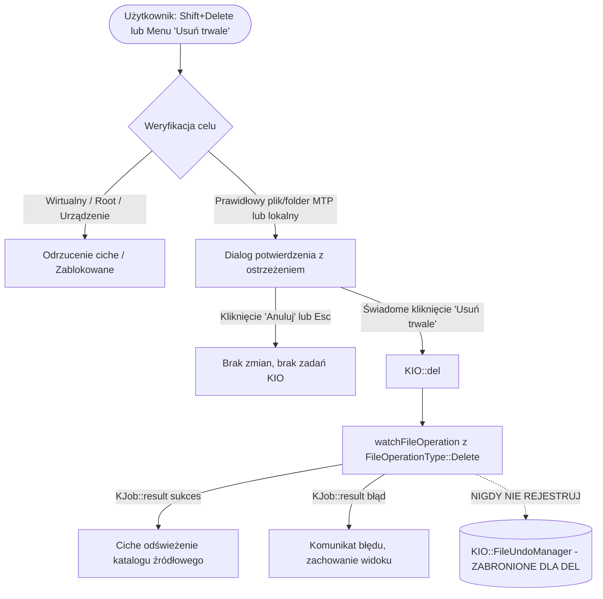

# ThisPC 0.41.2 — Stage 2.1: MTP Permanent Delete & Safety Contract

## 1. Wprowadzenie i kontekst audytu

W wersji ThisPC 0.41.1 użytkownik zgłosił brak możliwości usuwania plików na fizycznym telefonie komórkowym (vivo X300 Pro) podłączonym przez protokół KIO MTP:
- Pozycja **„Do Kosza”** w menu kontekstowym jest wyszarzona (`disabled`).
- W menu brakuje opcji **„Usuń trwale”** (`item.deletePermanently`).
- Skrót klawiszowy **`Shift+Delete`** nie wywołuje żadnej reakcji interfejsu.
- Skrót **`Delete`** nie reaguje na pozycjach MTP (brak dialogu potwierdzenia, brak akcji).
- Ten sam plik testowy (`thispc-mtp-copy-test.txt`) został bez przeszkód usunięty w menedżerze Dolphin za pomocą akcji „Usuń trwale”.

Niniejszy dokument stanowi formalny audyt architektury, analizę możliwości systemowych KDE Frameworks 6 oraz specyfikację kontraktu bezpieczeństwa i testów (`PD-001` – `PD-030`) dla etapu **Stage 2: MTP Permanent Delete**.

Zgodnie z dyscypliną projektową, **etap 2.1 nie wprowadza zmian w kodzie produkcyjnym** aplikacji ThisPC.

---

## 2. Diagnoza przyczyn źródłowych w ThisPC 0.41.1

Audyt kodu źródłowego (`src/`) wykazał cztery niezależne blokady uniemożliwiające usuwanie na nośnikach MTP:

### A. Blokada w `ActionStateController::compute`
Plik [`src/actionstatecontroller.cpp`](file:///home/sebastianh/Pobrane/kio-thispc/src/actionstatecontroller.cpp#L23-L37):
```cpp
bool allLocal = hasSelection;
for (const QUrl &url : input.selection) {
    allLocal = allLocal && url.isLocalFile();
}
...
state.trashEnabled = input.recoverySafe && allLocal;
```
Dla dowolnego pliku na urządzeniu MTP (`mtp:/...`), `url.isLocalFile()` zwraca `false`. W efekcie flaga `state.trashEnabled` otrzymuje wartość `false`, co powoduje bezwzględne wyszarzenie akcji w menu. W strukturze `ActionAvailability` w ogóle nie istniało pole dla trwałego usuwania (`permanentDeleteEnabled`).

### B. Twardy warunek lokalności w `FileActions::trashSelected`
Plik [`src/fileactions.h`](file:///home/sebastianh/Pobrane/kio-thispc/src/fileactions.h#L964-L974):
```cpp
for (const QUrl &url : urls) {
    if (!url.isLocalFile()) {
        QMessageBox::information(
            m_parentWidget,
            trLocal("Kosz", "Trash"),
            trLocal(
                "W tej wersji usuwanie do Kosza jest dostępne tylko dla lokalnych plików i folderów.",
                "In this version, moving to Trash is available only for local files and folders."));
        return;
    }
}
```
Metoda `trashSelected` potrafi obsługiwać wyłącznie `KIO::trash()` dla ścieżek `file://`. Próba wywołania jej na pliku MTP kończyła się komunikatem informacyjnym. W klasie `FileActions` brakowało metody `deleteSelected()` lub `deletePermanently()`.

### C. Brak akcji w menu kontekstowym (`PaneMenuController`)
Plik [`src/panemenucontroller.cpp`](file:///home/sebastianh/Pobrane/kio-thispc/src/panemenucontroller.cpp#L282-L284):
Menu zawiera wyłącznie wpis:
```cpp
addAction(menu, QStringLiteral("item.trash"), themedIcon(QStringLiteral("user-trash")),
          trLocal("Do Kosza", "Trash"), state.availability.trashEnabled,
          callbacks.trash);
```
Brak wpisu `item.deletePermanently` („Usuń trwale…”).

### D. Brak skrótu `Shift+Delete` w widoku
Plik [`src/thispcview.cpp`](file:///home/sebastianh/Pobrane/kio-thispc/src/thispcview.cpp#L2862-L2865):
Zarejestrowano wyłącznie:
```cpp
addViewShortcut(
    QKeySequence(Qt::Key_Delete),
    [this] { trashSelected(); });
```
Skrót `Shift+Delete` (`Qt::SHIFT | Qt::Key_Delete`) nie był w ogóle zarejestrowany w mapie skrótów `ThisPcWindow`.

---

## 3. Audyt możliwości KIO MTP i API KDE Frameworks 6

### A. Worker KIO MTP (`/usr/lib/qt6/plugins/kf6/kio/mtp.so`)
Weryfikacja biblioteki w systemie CachyOS (KF6 6.31.0 / kio-extras) potwierdziła obecność symboli:
- `deleteObject` -> wywołanie biblioteczne `LIBMTP_Delete_Object(device, object_id)`.
- Worker `kio_mtp` implementuje metodę `WorkerResult del(const QUrl &url, bool isfile)` dziedziczoną z `KIO::WorkerBase`.
- Protokół MTP obsługuje natywne usuwanie plików i katalogów przekazanych przez KIO.

### B. Dostępne API w `<kio/deletejob.h>`
W KDE Frameworks 6 usuwanie realizowane jest przez `KIO::DeleteJob`:
```cpp
KIOCORE_EXPORT DeleteJob *del(const QUrl &src, JobFlags flags = DefaultFlags);
KIOCORE_EXPORT DeleteJob *del(const QList<QUrl> &src, JobFlags flags = DefaultFlags);
```
Właściwości `KIO::DeleteJob`:
1. Jest zadaniem KJob (`KIO::Job` -> `KJob`), w pełni kompatybilnym z `ThisPcWindow::watchFileOperation`.
2. Przyjmuje listę URL-i (`QList<QUrl>`), umożliwiając usuwanie wielu zaznaczonych elementów w ramach jednego zadania.
3. Obsługuje flagę `KIO::HideProgressInfo`, co pozwala ThisPC na spójne raportowanie statusu.
4. W przypadku katalogów `KIO::DeleteJob` automatycznie przetwarza rekurencyjnie zawartość (odpytując `KProtocolManager::canDeleteRecursive(url)` lub usuwając elementy podrzędne).

### C. Zasada braku Kosza na urządzeniach MTP
Protokół MTP (Media Transfer Protocol) nie udostępnia koncepcji systemowego Kosza (Trash). Pliki usuwane na smartfonie są bezpowrotnie wyrejestrowywane z bazy danych mediów urządzenia i kasowane z pamięci flash (UFS/eMMC). Z tego powodu **akcja „Do Kosza” na MTP musi pozostać trwale nieaktywna**, a jedyną dopuszczalną formą usunięcia jest **świadome usuwanie trwałe**.

---

## 4. Architektura bezpieczeństwa (Safety Architecture)

Wdrożenie trwałego usuwania plików obarczone jest ryzykiem nieodwracalnej utraty danych użytkownika. Wprowadza się bezwzględne reguły architektoniczne:



### Reguła 1: Obowiązkowy dialog potwierdzenia
Żadne trwałe usunięcie nie może nastąpić bez uprzedniego potwierdzenia w oknie dialogowym:
- Komunikat musi zawierać jednoznaczne słowo **„nieodwracalnie”** / **„trwale”**.
- Dla pojedynczego pliku: wyświetlenie jego nazwy.
- Dla wielu plików: wyświetlenie dokładnej liczby elementów.
- Dla folderu: wyraźne ostrzeżenie, że folder oraz cała jego zawartość zostaną skasowane.
- Przyciski: **„Usuń trwale”** (`QDialogButtonBox::AcceptRole`) oraz **„Anuluj”** (`QDialogButtonBox::RejectRole`).
- **Domyślny fokus na „Anuluj”** (ochrona przed przypadkowym wciśnięciem klawisza Enter / Spacja).

### Reguła 2: Bezpieczeństwo korzeni i obiektów systemowych
Bezwzględny zakaz trwałego usuwania:
- Korzenia widoku „Ten komputer” (`thispc:/`).
- Wirtualnych nośników i napędów z listy dysków.
- Korzenia nośnika MTP (`mtp:/`, `mtp://<device>/`).
- Katalogów specjalnych i kosza (`trash:/`).
- Zaznaczeń nieaktualnych (gdy użytkownik zmienił katalog podczas trwania innej akcji).

### Reguła 3: Zakaz fałszywego Undo
`KIO::DeleteJob` pod żadnym pozorem nie może być rejestrowany w `m_undoController` / `KIO::FileUndoManager`. Użytkownik po usunięciu pliku przez `KIO::del` nie może mieć aktywnej opcji „Cofnij: Usuwanie”, która mogłaby wprowadzić go w błąd, że plik na telefonie da się przywrócić.

### Reguła 4: Nienaruszalność lokalnego Kosza
- Zwykły klawisz **`Delete`** na lokalnym systemie plików (`file://`) niezmiennie przenosi pliki do Kosza (`KIO::trash`).
- **`Shift+Delete`** na lokalnym systemie plików również może wywołać trwałe usuwanie z dialogiem ostrzegawczym (zgodnie ze standardem KDE Plasma / Windows).
- Klawisz `Delete` na plikach MTP nie może po cichu zamieniać się w trwałe usuwanie bez skrótu Shift lub świadomej decyzji.

### Reguła 5: Obsługa rozłączenia kabla MTP
Jeżeli podczas usuwania lub przed potwierdzeniem dialogu kabel USB zostanie odłączony:
- `KIO::DeleteJob` zwróci błąd (`KIO::ERR_SLAVE_DIED` lub podobny).
- ThisPC nie usuwa pliku z modelu widoku na ślepo.
- Następuje ciche odświeżenie i aktywacja paska `RemoteReconnectBar` („Połącz ponownie”).
- Brak cyklicznego pollingu MTP.

---

## 5. Tabela kontraktów testowych (PD-001 – PD-030)

| ID | Kategoria | Nazwa kontraktu | Metoda weryfikacji | Oczekiwany status Stage 2.1 |
|---|---|---|---|---|
| **PD-001** | Dostępność | Aktywacja `permanentDeleteEnabled` dla MTP | Test jednostkowy (`ActionStateController`) | **RED** |
| **PD-002** | Dostępność | `trashEnabled` pozostaje `false` dla MTP | Test jednostkowy (`ActionStateController`) | **GREEN** |
| **PD-003** | Menu | Obecność `item.deletePermanently` w menu | Test struktury menu (`PaneMenuController`) | **RED** |
| **PD-004** | Skróty | Rejestracja skrótu `Shift+Delete` | Test skrótów widoku (`ThisPcWindow`) | **RED** |
| **PD-005** | Skróty | Klawisz `Delete` zachowuje lokalny Kosz | Test skrótów widoku (`ThisPcWindow`) | **GREEN** |
| **PD-006** | Dialog | Obowiązkowy dialog przed wykonaniem `del` | Test kontraktu interakcji | **RED** |
| **PD-007** | Dialog | Prezentacja nazwy pojedynczego pliku | Weryfikacja tekstu dialogu | **RED** |
| **PD-008** | Dialog | Prezentacja liczby wielu zaznaczonych plików | Weryfikacja tekstu dialogu | **RED** |
| **PD-009** | Dialog | Ostrzeżenie o rekurencyjnym usuwaniu folderu | Weryfikacja tekstu dialogu | **RED** |
| **PD-010** | Dialog | Domyślny fokus na „Anuluj” | Test domyślnego przycisku dialogu | **RED** |
| **PD-011** | Anulowanie | Odrzucenie dialogu nie wywołuje zadania KIO | Test przechwytywania KJob | **RED** |
| **PD-012** | Anulowanie | Odrzucenie dialogu zachowuje zaznaczenie | Test zachowania stanu widoku | **RED** |
| **PD-013** | Wykonanie | Utworzenie `KIO::DeleteJob` dla 1 pliku | Weryfikacja typu tworzonego KJob | **RED** |
| **PD-014** | Wykonanie | Pomyślne usunięcie 1 pliku usuwa go z widoku | Test asynchronicznego zakończenia | **RED** |
| **PD-015** | Wykonanie | Utworzenie partii `KIO::del(QList<QUrl>)` | Test wieloobiektowego KJob | **RED** |
| **PD-016** | Wykonanie | Pomyślne usunięcie partii usuwa wszystkie | Test partii plików | **RED** |
| **PD-017** | Foldery | Usuwanie folderu na MTP | Test KIO del dla katalogu | **RED** |
| **PD-018** | Foldery | Rekurencyjne usuwanie podkatalogów | Test usuwania drzewa katalogów | **RED** |
| **PD-019** | Sprzęt | Rozłączenie kabla zwraca błąd KIO | Test obsługi błędu nośnika | **RED** (Hardware boundary) |
| **PD-020** | Sprzęt | Rozłączenie nie pozostawia wpisów widmowych | Test spójności modelu | **RED** (Hardware boundary) |
| **PD-021** | Błędy | Błąd uprawnień raportowany w status barze | Test obsługi błędów KIO | **RED** |
| **PD-022** | Błędy | Błąd nie czyści widoku katalogu | Test zachowania danych przy błędzie | **RED** |
| **PD-023** | Błędy | Częściowe usunięcie odświeża stan faktyczny | Test częściowego powodzenia | **RED** |
| **PD-024** | Zadania | Anulowanie `DeleteJob` zatrzymuje usuwanie | Test przerwania KJob | **RED** |
| **PD-025** | Integracja | Rejestracja w `FileOperationContext::Delete` | Test kontekstu operacji plikowej | **RED** |
| **PD-026** | Integracja | Zaliczenie kontraktu `DR-068` | Test cichego odświeżania po del | **RED** |
| **PD-027** | Split View | Izolacja paneli przy usuwaniu w Primary | Test niezależności Split View | **RED** |
| **PD-028** | Split View | Odświeżenie obu paneli przy tym samym MTP | Test synchronizacji obu paneli | **RED** |
| **PD-029** | Regresja | Brak wpływu na lokalny Kosz i przywracanie | Test regresji operacji lokalnych | **GREEN** |
| **PD-030** | Regresja | Zakaz rejestracji DeleteJob w FileUndoManager| Test braku fałszywego Undo | **RED** |

---

## 6. Plan implementacji (Stage 2.2 — Implementation)

Po zatwierdzeniu niniejszego audytu, prace wdrożeniowe zostaną podzielone na logiczne kroki:
1. **Rozszerzenie modelu stanów (`ActionStateController`):** dodanie flagi `permanentDeleteEnabled`, uwzględniającej MTP i lokalne pliki przy zachowaniu blokad dla `thispc:/` i napędów.
2. **Dodanie metody `deleteSelectedPermanently` w `FileActions`:** budowa bezpiecznego okna dialogowego z wyraźnym ostrzeżeniem, obsługa pojedynczych plików, partii i folderów.
3. **Uruchomienie `KIO::del`:** integracja z `watchFileOperation`, przypisanie typu `FileOperationType::Delete` i wykluczenie z `UndoController`.
4. **Rozbudowa menu i skrótów:** dodanie `item.deletePermanently` do `PaneMenuController` oraz powiązanie `Shift+Delete` w `ThisPcWindow`.
5. **Weryfikacja testowa:** przejście kontraktów `PD-001` – `PD-030` ze stanu RED do GREEN oraz potwierdzenie przejścia `DR-068`.
